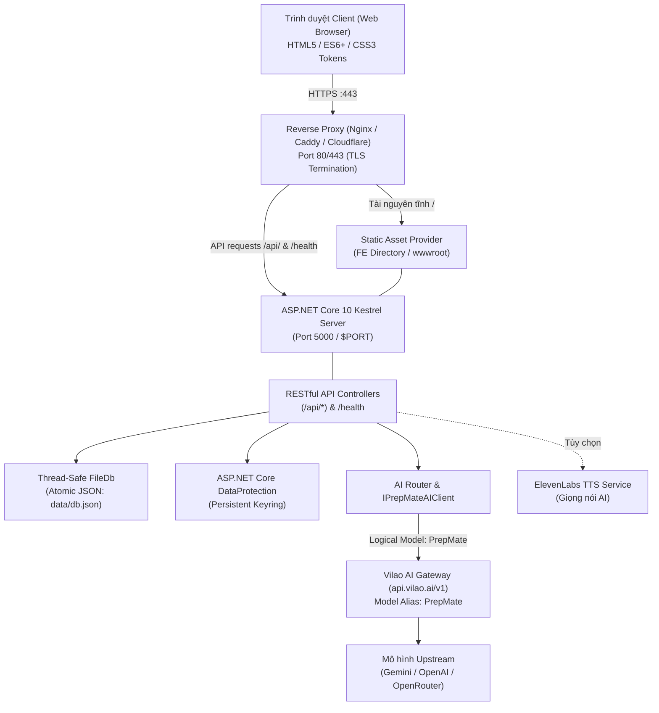
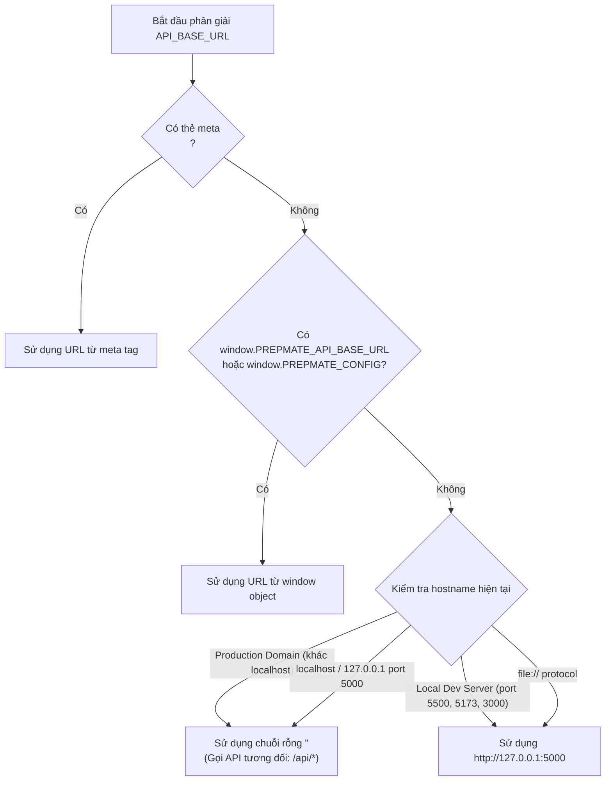

# PREPMATE — HƯỚNG DẪN TRIỂN KHAI VÀ VẬN HÀNH HỆ THỐNG (DEPLOYMENT GUIDE)

Tài liệu này cung cấp hướng dẫn toàn diện cho kỹ sư DevOps, quản trị viên hệ thống hoặc lập trình viên khi clone repository PrepMate để triển khai môi trường cục bộ (Local Development), môi trường kiểm thử (Staging) hoặc môi trường thực tế (Production).

---

## 1. Tổng Quan Kiến Trúc Hệ Thống

PrepMate là nền tảng luyện phỏng vấn trực tuyến ứng dụng trí tuệ nhân tạo (AI-Powered Multi-Industry Interview Preparation Platform), được xây dựng theo kiến trúc tối giản, hiệu năng cao và độc lập với môi trường chạy (Environment-Agnostic).

### 1.1 Các Thành Phần Kiến Trúc Chính



- **Frontend (FE):** Giao diện Web không phụ thuộc framework ngoài (Zero-Framework Vanilla HTML5, CSS3 Custom Properties Tokens, ES6+ JavaScript, Web Components). Giao diện có thể được Kestrel phục vụ trực tiếp từ thư mục `FE/` hoặc được phân phối qua CDN / Reverse Proxy độc lập.
- **Backend (BE):** Xây dựng trên nền tảng **.NET 10.0** (C# 13), sử dụng máy chủ HTTP Kestrel tích hợp, phục vụ RESTful API, quản lý phiên phỏng vấn, kiểm soát hạn ngạch (quota) và phân bổ đánh giá.
- **Database & Persistence (`FileDb`):** Hệ thống lưu trữ Single-File JSON SSOT (`data/db.json`). Quản lý bộ nhớ đệm luồng (`ConcurrentDictionary`) kết hợp cơ chế ghi tệp nguyên tử (Atomic file write qua tệp `.tmp`, xác thực tính toàn vẹn JSON trước khi thay thế) và ghi nhật ký thay đổi.
- **Cơ Chế Bảo Vệ Khóa Bí Mật (`DataProtection`):** Sử dụng `Microsoft.AspNetCore.DataProtection` để mã hóa và giải mã an toàn các API key do quản trị viên thiết lập từ Admin Console, lưu trữ keyring ngoài cây thư mục git.
- **Hệ Thống Trí Tuệ Nhân Tạo (AI Subsystem):** 
  - Điểm truy cập chuẩn: **Single AI Gateway (`https://api.vilao.ai/v1`)** với định danh mô hình logic **`PrepMate`**.
  - Tích hợp upstream linh hoạt: Khi không dùng Vilao Gateway, có thể cấu hình trực tiếp Google Gemini, OpenAI hoặc OpenRouter.
  - Cơ chế an toàn (Fail-Safe): Tự động chuyển sang `NoAiModeService` (chế độ suy luận xác định) khi thiếu credentials hoặc mạng gián đoạn, ngăn chặn hoàn toàn lỗi HTTP 500 trong phòng phỏng vấn.

### 1.2 Phân Biệt Giữa Môi Trường Development và Production

| Tiêu Chí | Môi Trường Development | Môi Trường Production |
| :--- | :--- | :--- |
| `ASPNETCORE_ENVIRONMENT` | `Development` | `Production` |
| **Cổng lắng nghe** | `http://localhost:5000` | Nội bộ Kestrel (`127.0.0.1:5000` hoặc `$PORT`) sau Reverse Proxy HTTPS |
| **Khóa ký JWT (`JWT__SECRET`)** | Tự động dùng fallback built-in dev secret nếu để trống | **BẮT BUỘC** khai báo; tối thiểu 32 ký tự. Lỗi dừng server nếu thiếu |
| **Khóa ký Guest (`GUEST_TOKEN__SIGNING_KEY`)**| Tự động dùng fallback built-in dev guest secret | **BẮT BUỘC** khai báo; tối thiểu 32 ký tự và **PHẢI KHÁC** `JWT__SECRET` |
| **Cơ sở dữ liệu (`FileDb`)** | Tự động khởi tạo dữ liệu mẫu (Auto-Seeding) nếu chưa có `db.json` | **NGHIÊM CẤM TỰ SEED**. Ném ngoại lệ `FileNotFoundException` nếu thiếu tệp `db.json` để chống mất mát dữ liệu |
| **Chính sách CORS** | `AllowAll` (Chấp nhận mọi origin cục bộ với credentials) | `ProductionCorsPolicy` (Ràng buộc nghiêm ngặt theo danh sách `Cors:AllowedOrigins`) |
| **Xử lý ngoại lệ (Exception)** | Trả về thông tin phục vụ debug | Bọc qua Global Exception Sanitizer: Trả về thông báo chung, ngăn rò rỉ mã lỗi và thông tin hệ thống |
| **Bảo vệ tiêu đề HTTP** | Đầy đủ | Bổ sung `Cache-Control: no-store` cho API/HTML, `X-Content-Type-Options: nosniff`, `X-Frame-Options: SAMEORIGIN` |

---

## 2. Yêu Cầu Môi Trường (System Prerequisites)

### 2.1 Phiên Bản Công Cụ Cần Thiết

- **.NET SDK:** Phiên bản **10.0** trở lên (Cần thiết để build và chạy Backend). Kiểm tra: `dotnet --version`.
- **Node.js:** Phiên bản **18.0** trở lên (Khuyến nghị Node 20 LTS hoặc Node 24). Sử dụng riêng cho bộ test tự động (test runner) hoàn toàn không có thư viện bên ngoài (Zero npm dependencies, 100% Native Node.js modules). Kiểm tra: `node -v`.
- **Git:** Phiên bản **2.40** trở lên.

### 2.2 Các Lệnh Thực Thi Đã Được Xác Minh (Verified CLI Commands)

Tất cả các lệnh dưới đây được xác minh trực tiếp từ project file `BE/backend.csproj` và bộ test tại `tests/run-all.js`.

```bash
# 1. Di chuyển vào thư mục gốc repository
cd /path/to/PrepMate

# 2. Khôi phục dependencies cho Backend (.NET)
dotnet restore BE/backend.csproj

# 3. Biên dịch Backend (Debug hoặc Release)
dotnet build BE/backend.csproj -c Release

# 4. Chạy bộ hồi quy kiểm thử tự động (61 suites, 1244 checks PASS hoàn toàn)
node tests/run-all.js

# 5. Chạy ứng dụng cục bộ từ thư mục gốc
dotnet run --project BE/backend.csproj

# 6. Đóng gói ứng dụng để triển khai (Self-contained hoặc Framework-dependent)
dotnet publish BE/backend.csproj -c Release -o ./publish /p:UseAppHost=false
```

> [!NOTE]
> Khi thực hiện lệnh `dotnet publish`, cấu hình trong `BE/backend.csproj` đã được thiết lập tự động copy toàn bộ nội dung thư mục `FE/` vào thư mục xuất bản `./publish/FE/`. Kestrel sẽ tự động phân giải và phục vụ static bundle này mà không cần cấu hình thêm đường dẫn thủ công.

---

## 3. Cấu Hình Môi Trường (Environment Variables)

### 3.1 Bảng Biến Môi Trường Chi Tiết

PrepMate hỗ trợ cấu hình qua biến môi trường hệ điều hành hoặc qua tệp `appsettings.Production.json`. .NET tự động ánh xạ dấu gạch dưới kép `__` trong tên biến thành phân cấp dấu hai chấm `:` trong IConfiguration.

| Tên Biến Môi Trường | Khóa Cấu Hình .NET | Bắt Buộc? | Môi Trường | Giá Trị Mặc Định / Mẫu | Mục Đích Sử Dụng |
| :--- | :--- | :--- | :--- | :--- | :--- |
| `ASPNETCORE_ENVIRONMENT` | - | Khuyến nghị | Tất cả | `Production` | Xác định môi trường hoạt động của máy chủ |
| `ASPNETCORE_URLS` | `Urls` | Tùy chọn | Prod/Staging | `http://*:5000` | Địa chỉ IP và cổng Kestrel lắng nghe |
| `PORT` | - | Tùy chọn | Container/PaaS | `5000` | Cổng Kestrel (tương thích Cloud Run, Heroku, Render) |
| `WEB_ROOT_PATH` | - | Tùy chọn | Tùy chỉnh | `(auto-detect FE)` | Đường dẫn thư mục giao diện tĩnh Frontend |
| `DATABASE_FILE_PATH` | `Database:FilePath` | Khuyến nghị | Production | `data/db.json` | Đường dẫn tệp cơ sở dữ liệu FileDb SSOT |
| `PREPMATE_KEYRING_PATH` | `DataProtection:KeyDirectory` | Khuyến nghị | Production | `/var/prepmate/keys` | Thư mục lưu trữ khóa mã hóa DataProtection |
| `JWT__SECRET` | `Jwt:Secret` | **Bắt buộc** | Production | `REPLACE_ON_DEPLOYMENT` | Khóa ký số JWT token (tối thiểu 32 ký tự / 256-bit) |
| `JWT__ISSUER` | `Jwt:Issuer` | Tùy chọn | Tất cả | `PrepMateBackend` | Định danh tổ chức phát hành token |
| `JWT__AUDIENCE` | `Jwt:Audience` | Tùy chọn | Tất cả | `PrepMateFrontend` | Định danh đối tượng nhận token |
| `GUEST_TOKEN__SIGNING_KEY` | `GuestToken:SigningKey` | **Bắt buộc** | Production | `REPLACE_ON_DEPLOYMENT` | Khóa ký HMAC phiên khách ẩn danh (Khác JWT__SECRET) |
| `GUEST_TOKEN__PREVIOUS_SIGNING_KEYS` | `GuestToken:PreviousSigningKeys` | Tùy chọn | Production | `KEY1,KEY2` | Danh sách khóa cũ hỗ trợ đảo khóa khách mượt mà |
| `Cors__AllowedOrigins__0` | `Cors:AllowedOrigins:0` | Điều kiện | Production | `https://prepmate.vn` | Domain FE được cấp phép gửi request có cookie/auth |
| `PREPMATE_AI_API_KEY` | - | Tùy chọn | Tất cả | `REPLACE_ON_DEPLOYMENT` | Khóa API hợp nhất cho toàn bộ dịch vụ AI |
| `VILAO_API_KEY` | - | Khuyến nghị | Tất cả | `REPLACE_ON_DEPLOYMENT` | Khóa cổng Vilao AI Gateway (`https://api.vilao.ai/v1`) |
| `GEMINI_API_KEY` | - | Tùy chọn | Tất cả | `REPLACE_ON_DEPLOYMENT` | Khóa Google Gemini trực tiếp (dự phòng) |
| `OPENAI_API_KEY` | - | Tùy chọn | Tất cả | `REPLACE_ON_DEPLOYMENT` | Khóa OpenAI trực tiếp (dự phòng Slot 3) |
| `OPENROUTER_API_KEY` | - | Tùy chọn | Tất cả | `REPLACE_ON_DEPLOYMENT` | Khóa OpenRouter trực tiếp (dự phòng Slot 4) |
| `ELEVENLABS_API_KEY` | `ElevenLabs:ApiKey` | Tùy chọn | Tất cả | `REPLACE_ON_DEPLOYMENT` | Khóa ElevenLabs TTS tổng hợp giọng nói |
| `ELEVENLABS_BASE_URL` | `ElevenLabs:BaseUrl`| Tùy chọn | Tất cả | `https://api.elevenlabs.io`| Base URL của dịch vụ ElevenLabs |
| `ELEVENLABS_ZERO_RETENTION_ENABLED` | `ElevenLabs:ZeroRetentionEnabled` | Tùy chọn | Tất cả | `false` | Cờ bảo mật dữ liệu Enterprise cho ElevenLabs |

### 3.2 Cơ Chế Ưu Tiên Cấu Hình AI Giữa Biến Môi Trường và Admin Console

Hệ thống PrepMate có cơ chế phân tầng bảo mật cho AI Credentials (`ProviderRegistryService` và `AIConfigurationService`):
1. **Chế độ `auto` (Mặc định):** Biến môi trường (`PREPMATE_AI_API_KEY` -> `VILAO_API_KEY` -> `GEMINI_API_KEY` -> `OPENAI_API_KEY`) luôn được ưu tiên cao nhất. Nếu không có biến môi trường, hệ thống sẽ sử dụng khóa được Admin nhập từ giao diện và giải mã qua `DataProtection`.
2. **Chế độ `environment`:** Bắt buộc chỉ nhận credentials từ biến môi trường.
3. **Chế độ `admin`:** Chỉ nhận credentials được mã hóa trong `FileDb`.
4. **Bảo mật tuyệt đối (Zero Exposure):** Khi trả DTO về client quản trị hoặc in log, hệ thống chỉ phản hồi cờ `ApiKeyConfigured: true/false`, định danh `CredentialSource` và trạng thái mã hóa. **Tuyệt đối không bao giờ trả plaintext API key về client hoặc in vào console log.**

---

## 4. Secrets và Quản Lý Bảo Mật (Secrets & Cryptographic Safety)

### 4.1 Khởi Tạo Signing Secrets An Toàn

Hệ thống yêu cầu tách bạch mật mã (**Cryptographic Key Separation**): Khóa ký JWT của người dùng đã xác thực và Khóa HMAC của khách ẩn danh (`GuestToken`) **bắt buộc phải là hai chuỗi ký tự độc lập, khác nhau hoàn toàn**.

Sử dụng một trong các lệnh sau để tạo khóa 256-bit ngẫu nhiên:

```bash
# Sử dụng OpenSSL (Linux / macOS / Git Bash)
openssl rand -base64 32

# Hoặc trên PowerShell (Windows)
[Convert]::ToBase64String((1..32 | ForEach-Object { Get-Random -Minimum 0 -Maximum 256 }))
```

> [!CAUTION]
> Trong môi trường `Production`, nếu `JWT__SECRET` hoặc `GUEST_TOKEN__SIGNING_KEY` để trống hoặc có độ dài nhỏ hơn 32 ký tự, hoặc nếu hai khóa này giống hệt nhau, `BE/Program.cs` sẽ ném ngoại lệ `InvalidOperationException` và lập tức dừng khởi động hệ thống (Fail-Closed).

### 4.2 Lưu Trữ Bí Mật và Quy Trình Khi Rò Rỉ Khóa

- **Không bao giờ commit secrets vào Git:** Tệp `.gitignore` đã chặn các tệp `.env`, `.env.*` (ngoại trừ `.env.example`), các tệp khóa `*.key`, `*.pem`, `*.pfx`.
- **Nếu phát hiện khóa bí mật bị lộ:**
  1. Thay thế ngay lập tức `JWT__SECRET` bằng một khóa mới trong secret manager của máy chủ.
  2. Khởi động lại service. Tất cả các token JWT cũ của người dùng sẽ lập tức mất hiệu lực; người dùng sẽ cần đăng nhập lại để nhận token mới.
  3. Để thay đổi `GUEST_TOKEN__SIGNING_KEY` mà không làm gián đoạn các phiên ứng viên khách đang phỏng vấn dở dang, đưa khóa cũ vào biến `GUEST_TOKEN__PREVIOUS_SIGNING_KEYS` và cập nhật khóa mới vào `GUEST_TOKEN__SIGNING_KEY`.

---

## 5. Kết Nối Frontend – Backend (FE–BE Connectivity)

### 5.1 Cơ Chế Tự Động Phân Giải API Base URL Của Frontend

Mọi tệp xử lý mạng ở Frontend (`FE/shared/js/main.js`, `auth.js`, `interview-api.js`, `report.js`) đều tuân theo chuỗi ưu tiên phân giải thống nhất:



### 5.2 Khuyến Nghị Kiến Trúc Phục Vụ (Same-Origin vs Cross-Origin)

1. **Khuyến nghị chuẩn (Same-Origin via Reverse Proxy):**
   - Đặt cả Frontend và Backend sau cùng một domain (ví dụ `https://prepmate.vn`).
   - Reverse Proxy điều hướng `/api/*` và `/health` vào Backend Kestrel (`127.0.0.1:5000`), còn lại phục vụ tệp tĩnh Frontend.
   - Lợi ích: Triệt tiêu hoàn toàn rủi ro và độ trễ của CORS preflight request (OPTIONS), không để lộ cổng nội bộ ra Internet.
2. **Triển khai tách biệt (Cross-Origin Deployment):**
   - Áp dụng khi Frontend đưa lên CDN tĩnh (Vercel, Cloudflare Pages, S3) tại domain `https://app.prepmate.vn` và Backend tại `https://api.prepmate.vn`.
   - **Bắt buộc cấu hình:**
     - Trong Backend: Đặt biến môi trường `Cors__AllowedOrigins__0=https://app.prepmate.vn`.
     - Trong Frontend: Chèn thẻ meta vào thẻ `<head>` của các file HTML:
       ```html
       <meta name="prepmate-api-base-url" content="https://api.prepmate.vn">
       ```
     - **Lưu ý:** Tuyệt đối không nhầm lẫn origin của Frontend với API origin.

---

## 6. Cơ Sở Dữ Liệu và Dữ Liệu Bền Vững (Database & Persistence)

### 6.1 Bản Chất FileDb và Giới Hạn Kiến Trúc (Single-Instance Constraint)

`FileDb` là cơ sở dữ liệu lưu trữ dưới dạng một tệp JSON duy nhất (`data/db.json`):
- **Cơ chế ghi an toàn (Atomic File Swap):** Khi lưu dữ liệu, hệ thống ghi toàn bộ state ra tệp tạm `.tmp`, xác thực tính toàn vẹn và cú pháp JSON, sau đó thực hiện đổi tên đè tệp cũ (`File.Move(..., overwrite: true)`).
- **Giới hạn quy mô (Scale-up Constraint):** `FileDb` sử dụng khóa bộ nhớ luồng nội bộ (`lock` và `ConcurrentDictionary`) để chống race condition giữa các thread. **Hệ thống KHÔNG hỗ trợ Distributed Lock**. Do đó:
  > [!WARNING]
  > **KHÔNG BAO GIỜ** scale ngang (horizontal scaling / chạy nhiều container replica) cùng trỏ vào một tệp `db.json`. Nhiều tiến trình ghi đồng thời sẽ gây xung đột file system lock hoặc làm mất dữ liệu của nhau. Nếu cần mở rộng quy mô, chỉ chạy một tiến trình duy nhất (Single-Instance), hoặc chuyển đổi tầng lưu trữ sang DBMS phân tán (PostgreSQL / SQL Server).

### 6.2 Thứ Tự Ưu Tiên Phân Giải Đường Dẫn Database Của Backend

Trong `BE/Services/Storage/FileDb.cs` (`ResolveDatabasePath`), đường dẫn tệp cơ sở dữ liệu được xác định theo thứ tự ưu tiên giảm dần:

1. **Tham số explicit (`explicitPath`):** Được truyền trực tiếp khi khởi tạo instance `FileDb` trong mã kiểm thử hoặc custom bootstrapper.
2. **Biến môi trường `DATABASE_FILE_PATH`:** Biến độc lập cấp cao nhất, thường dùng khi triển khai container hoặc server:
   ```bash
   export DATABASE_FILE_PATH="/var/prepmate/data/db.json"
   ```
3. **Cấu hình `Database:FilePath` trong .NET Configuration:** Đọc từ `appsettings*.json` hoặc qua biến môi trường dạng phân cấp:
   ```bash
   export DATABASE__FILEPATH="/var/prepmate/data/db.json"
   # hoặc
   export DATABASE__FILE_PATH="/var/prepmate/data/db.json"
   ```
4. **Mặc định dự phòng (Fallback):** Tệp `data/db.json` được giải quyết tương đối dựa trên `ContentRootPath` của ứng dụng (`Path.Combine(ContentRootPath, "data", "db.json")`).

### 6.3 Điều Kiện Khởi Động An Toàn Trong Production (Fail-Closed Gate)

Trong `BE/Services/Storage/FileDb.cs`:
```csharp
if (isProduction && !File.Exists(_filePath))
{
    throw new FileNotFoundException(
        $"[FileDb] FATAL: Persistent database not found at '{_filePath}'. " +
        "Auto-seeding is strictly disabled in Production environment to prevent silent data loss. " +
        "Please provide an existing database or run manual bootstrap.");
}
```
Khi khởi chạy với `ASPNETCORE_ENVIRONMENT=Production`, backend **từ chối tự khởi tạo dữ liệu seed**. Nếu tệp database chưa tồn tại, server sẽ dừng ngay lập tức với ngoại lệ `FileNotFoundException`.

### 6.4 Quy Trình Khởi Tạo & Vận Hành Database (Database Provisioning & Lifecycle)

Repository cung cấp sẵn tệp template an toàn [**`BE/data/db.example.json`**](file:///c:/Users/hungd/Desktop/VS%20Code/PrepMate/PrepMate/BE/data/db.example.json). Tệp này đã được kiểm chứng tuân thủ nghiêm ngặt điều kiện schema `IsValidDatabaseData`:
- Chứa duy nhất 1 tài khoản quản trị khởi tạo (`user_admin`, email `admin@prepmate.local`, username `admin`), với giá trị `PasswordHash: "LOCKED_INITIAL_ADMIN_ACCOUNT_PROVISION_REQUIRED"`.
  > [!IMPORTANT]
  > **Bảo Mật Tuyệt Đối (No Default Password):** Tài khoản này bị khóa mặc định ở trạng thái nghỉ, **hoàn toàn không có mật khẩu mặc định** (như `Admin@123` hay bất kỳ chuỗi cố định nào). Không ai có thể đăng nhập cho đến khi người triển khai kích hoạt bằng công cụ bootstrap độc lập.
- Chứa cấu hình AI mặc định (`Id: "default"`, `Provider: "Vilao AI"`, `Model: "PrepMate"`, `BaseUrl: "https://api.vilao.ai/v1/"`).
- Các collection `Sessions: {}`, `Transactions: []`, `CVs: {}` hoàn toàn rỗng, không chứa dữ liệu nhạy cảm hay thông tin cá nhân của người dùng.

#### Kịch bản 1: Khởi Tạo Triển Khai Mới (Fresh Deployment Provisioning)
Khi clone repository lên máy chủ mới hoặc tạo môi trường mới:
```bash
# 1. Tạo thư mục persistent trên máy chủ
sudo mkdir -p /var/prepmate/data
sudo mkdir -p /var/prepmate/keys
sudo chown -R prepmate:prepmate /var/prepmate
sudo chmod 750 /var/prepmate/data
sudo chmod 700 /var/prepmate/keys

# 2. Sao chép template mẫu sang đường dẫn database chính thức
sudo cp BE/data/db.example.json /var/prepmate/data/db.json
sudo chown prepmate:prepmate /var/prepmate/data/db.json
sudo chmod 640 /var/prepmate/data/db.json

# 3. Kích hoạt tài khoản admin với mật khẩu ngẫu nhiên an toàn (Không lưu vào Git hay Log)
node scripts/bootstrap-admin.js /var/prepmate/data/db.json
# (Hoặc chỉ định mật khẩu cụ thể: node scripts/bootstrap-admin.js /var/prepmate/data/db.json --password "MatKhauTuyChonCuaBan")
# Lưu lại mật khẩu xuất hiện một lần trên terminal vào Password Manager.
```

> [!TIP]
> **Cơ Chế Ghi Nguyên Tử (Atomic Replace) & Lưu Ý Vận Hành:**
> Tiện ích `bootstrap-admin.js` tạo tệp tạm ngay trong cùng thư mục với `db.json`, ghi dữ liệu và gọi `fsync` trước khi thực hiện atomic replace qua `fs.renameSync`. Tiện ích tuyệt đối **không dùng fallback ghi đè trực tiếp** (`copyFileSync`) để triệt tiêu nguy cơ tệp bị hỏng dở dang nếu xảy ra sự cố.
> - **Trên Linux/POSIX:** Hoán đổi qua `rename(2)` bảo đảm tính nguyên tử (atomic) ở tầng nhân hệ điều hành khi cùng filesystem.
> - **Trên Windows (NTFS):** `MoveFileExW` hỗ trợ thay thế nguyên tử khi không có tiến trình nào giữ exclusive file lock. Hãy đảm bảo service backend đã dừng trước khi chạy bootstrap trên môi trường Windows. Nếu thao tác thất bại, script sẽ hủy tệp tạm và bảo toàn nguyên vẹn 100% tệp database đích.

> [!NOTE]
> **Định Hướng Kiến Trúc Về Bootstrap Admin Tự Động:**
> Hiện tại, logic khởi tạo admin ngẫu nhiên được đóng gói độc lập trong tiện ích chuẩn [`scripts/bootstrap-admin.js`](file:///c:/Users/hungd/Desktop/VS%20Code/PrepMate/PrepMate/scripts/bootstrap-admin.js) nhằm bảo vệ tính toàn vẹn của mã nguồn backend. Nếu trong tương lai hệ thống mở rộng hỗ trợ biến môi trường tự động nạp lúc khởi động (ví dụ `PREPMATE_ADMIN_PASSWORD`), giải pháp tối thiểu cần bổ sung:
> 1. Kiểm tra biến môi trường trong `FileDb.cs` hoặc `Program.cs` khi `user_admin.PasswordHash` mang tiền tố `LOCKED_`.
> 2. Bổ sung cờ `MustChangePassword` trên model `User` để bắt buộc đổi mật khẩu ngay tại lần đăng nhập đầu tiên qua API `/api/auth/change-password`.
> 3. Tuyệt đối không in mật khẩu ra console log trong môi trường Production.

#### Kịch bản 2: Khôi Phục Database Đã Có Dữ Liệu (Restoring Existing Database)
Khi di chuyển máy chủ hoặc khôi phục dữ liệu từ môi trường trước:
```bash
# 1. Sao chép tệp backup vào đường dẫn đích
sudo cp /path/to/backup_db.json /var/prepmate/data/db.json
sudo chown prepmate:prepmate /var/prepmate/data/db.json
sudo chmod 640 /var/prepmate/data/db.json

# 2. Khởi động lại service
sudo systemctl restart prepmate
```
Khi khởi động, `FileDb` sẽ tự động xác thực tính toàn vẹn của tệp qua `IsValidDatabaseData`. Nếu tệp hợp lệ, hệ thống nạp dữ liệu bình thường.

#### Kịch bản 3: Tự Động Phục Hồi Khi Gặp Sự Cố (Crash Recovery)
Nếu máy chủ bị mất điện hoặc crash đột ngột trong khi đang ghi:
- Tệp chính `db.json` không bị hỏng nhờ cơ chế Atomic Swap.
- Nếu tệp `.tmp` hợp lệ còn sót lại, `FileDb` có thể tự động khôi phục từ tệp `.tmp` và lưu vết.
- Nếu tệp `db.json` bị hỏng cú pháp (malformed JSON), `FileDb` sẽ tự động sao lưu tệp lỗi thành `db.json.corrupt.<timestamp>` và dừng server với `InvalidOperationException` để quản trị viên can thiệp, ngăn chặn ghi đè làm mất vĩnh viễn dữ liệu.

#### Kịch bản 4: Chiến Lược Sao Lưu Định Kỳ (Backup Strategy)
Thiết lập cron job định kỳ sao lưu tệp `db.json`:
```bash
# Sao lưu mỗi giờ vào thư mục backup riêng biệt
0 * * * * cp /var/prepmate/data/db.json /var/prepmate/backups/db_$(date +\%Y\%m\%d_\%H\%M\%S).json
```

#### Bảo tồn khóa DataProtection Keyring
Thư mục `/var/prepmate/keys` (hoặc `PREPMATE_KEYRING_PATH`) lưu các khóa bảo vệ của ASP.NET Core. **Nếu thư mục này bị mất hoặc bị ghi đè, toàn bộ các API key AI đã lưu trước đó trong cơ sở dữ liệu sẽ không thể giải mã được.** Bắt buộc mount thư mục này vào persistent storage volume khi chạy container hoặc sao lưu cùng với database.

---

## 7. Các Phương Án Triển Khai (Deployment Options)

### Phương Án A: Triển Khai Trực Tiếp Trên Linux VPS (Systemd + Nginx) — Khuyến Nghị Native

Đây là phương án tối ưu về tài nguyên và hiệu năng đối với kiến trúc hiện tại của PrepMate.

#### Bước 1: Cài đặt .NET 10 Runtime trên Ubuntu/Debian
```bash
sudo apt-get update
sudo apt-get install -y dotnet-aspnetcore-runtime-10.0
```

#### Bước 2: Tạo User và Thư Mục Triển Khai
```bash
sudo useradd -r -s /bin/false prepmate
sudo mkdir -p /var/www/prepmate
sudo mkdir -p /var/prepmate/data
sudo mkdir -p /var/prepmate/keys
```

#### Bước 3: Đóng gói và chuyển mã nguồn
Tại máy build:
```bash
dotnet publish BE/backend.csproj -c Release -o ./publish /p:UseAppHost=false
rsync -avz ./publish/ user@your-server-ip:/var/www/prepmate/
```
Gán quyền cho user:
```bash
sudo chown -R prepmate:prepmate /var/www/prepmate
sudo chown -R prepmate:prepmate /var/prepmate
```

#### Bước 4: Tạo tệp biến môi trường an toàn (`/etc/prepmate.env`)
```ini
ASPNETCORE_ENVIRONMENT=Production
ASPNETCORE_URLS=http://127.0.0.1:5000
DATABASE_FILE_PATH=/var/prepmate/data/db.json
PREPMATE_KEYRING_PATH=/var/prepmate/keys
JWT__SECRET=CHUOINGAUNHIEN_TOITHIEU_32_KYTU_DANG_BASE64
GUEST_TOKEN__SIGNING_KEY=CHUOINGAUNHIEN_KHAC_TOITHIEU_32_KYTU
VILAO_API_KEY=sk-vilao-your-api-key-here
```
Bảo vệ quyền truy cập file secret:
```bash
sudo chown root:prepmate /etc/prepmate.env
sudo chmod 640 /etc/prepmate.env
```

#### Bước 5: Tạo Systemd Service (`/etc/systemd/system/prepmate.service`)
```ini
[Unit]
Description=PrepMate Interview Platform (.NET 10)
After=network.target

[Service]
WorkingDirectory=/var/www/prepmate
ExecStart=/usr/bin/dotnet /var/www/prepmate/backend.dll
Restart=always
RestartSec=10
KillSignal=SIGINT
SyslogIdentifier=prepmate
User=prepmate
EnvironmentFile=/etc/prepmate.env

[Install]
WantedBy=multi-user.target
```
Kích hoạt và khởi động:
```bash
sudo systemctl daemon-reload
sudo systemctl enable prepmate
sudo systemctl start prepmate
sudo systemctl status prepmate
```

#### Bước 6: Cấu hình Nginx Reverse Proxy (`/etc/nginx/sites-available/prepmate.conf`)
```nginx
server {
    listen 80;
    server_name prepmate.yourdomain.com;
    return 301 https://$host$request_uri;
}

server {
    listen 443 ssl http2;
    server_name prepmate.yourdomain.com;

    ssl_certificate /etc/letsencrypt/live/prepmate.yourdomain.com/fullchain.pem;
    ssl_certificate_key /etc/letsencrypt/live/prepmate.yourdomain.com/privkey.pem;
    ssl_protocols TLSv1.2 TLSv1.3;

    # Bảo vệ HTTP Security Headers
    add_header X-Content-Type-Options "nosniff" always;
    add_header X-Frame-Options "SAMEORIGIN" always;
    add_header Referrer-Policy "strict-origin-when-cross-origin" always;

    # Phục vụ Frontend tĩnh
    location / {
        root /var/www/prepmate/FE;
        index index.html;
        try_files $uri $uri/ /index.html;
    }

    # Chuyển tiếp API sang Kestrel
    location /api/ {
        proxy_pass http://127.0.0.1:5000;
        proxy_http_version 1.1;
        proxy_set_header Upgrade $http_upgrade;
        proxy_set_header Connection keep-alive;
        proxy_set_header Host $host;
        proxy_set_header X-Real-IP $remote_addr;
        proxy_set_header X-Forwarded-For $proxy_add_x_forwarded_for;
        proxy_set_header X-Forwarded-Proto $scheme;
        proxy_set_header X-Forwarded-Host $server_name;
        proxy_read_timeout 90s;
    }

    # Health Check Endpoint
    location /health {
        proxy_pass http://127.0.0.1:5000/health;
        proxy_set_header Host $host;
    }
}
```
Kiểm tra cấu hình và reload Nginx:
```bash
sudo nginx -t && sudo systemctl reload nginx
```

---

### Phương Án B: Triển Khai Bằng Docker & Docker Compose (Cấu Hình Tham Khảo)

> [!NOTE]
> Cấu hình dưới đây là mẫu tham khảo chuẩn mực theo cấu trúc mã nguồn PrepMate. Cấu hình này chưa được kiểm thử trực tiếp trên Docker daemon trong phiên làm việc này. Nếu sử dụng, vui lòng kiểm tra việc cài đặt Docker engine và cấp quyền truy cập volume storage.

#### 1. `Dockerfile` (Đặt tại thư mục gốc repository)
```dockerfile
# Stage 1: Build .NET Backend
FROM mcr.microsoft.com/dotnet/sdk:10.0 AS build
WORKDIR /src
COPY BE/backend.csproj BE/
RUN dotnet restore BE/backend.csproj
COPY BE/ BE/
RUN dotnet publish BE/backend.csproj -c Release -o /app/publish /p:UseAppHost=false

# Stage 2: Runtime Environment
FROM mcr.microsoft.com/dotnet/aspnet:10.0 AS runtime
WORKDIR /app
EXPOSE 5000
ENV ASPNETCORE_URLS=http://+:5000
ENV ASPNETCORE_ENVIRONMENT=Production

COPY --from=build /app/publish .
COPY FE/ /app/FE/

VOLUME ["/app/data", "/app/keys"]

HEALTHCHECK --interval=30s --timeout=5s --start-period=10s --retries=3 \
  CMD curl -f http://localhost:5000/health || exit 1

ENTRYPOINT ["dotnet", "backend.dll"]
```

#### 2. `docker-compose.yml`
```yaml
version: '3.8'

services:
  prepmate:
    build:
      context: .
      dockerfile: Dockerfile
    restart: unless-stopped
    ports:
      - "127.0.0.1:5000:5000"
    environment:
      - ASPNETCORE_ENVIRONMENT=Production
      - DATABASE_FILE_PATH=/app/data/db.json
      - PREPMATE_KEYRING_PATH=/app/keys
      - JWT__SECRET=${JWT__SECRET}
      - GUEST_TOKEN__SIGNING_KEY=${GUEST_TOKEN__SIGNING_KEY}
      - VILAO_API_KEY=${VILAO_API_KEY}
    volumes:
      - prepmate_data:/app/data
      - prepmate_keys:/app/keys

volumes:
  prepmate_data:
  prepmate_keys:
```

---

## 8. Danh Sách Kiểm Tra Sau Triển Khai (Post-Deployment Checklist)

Sau khi khởi chạy ứng dụng trên máy chủ, thực hiện lần lượt các bước kiểm thử sau:

1. **Kiểm Tra Build & Test Tự Động:**
   ```bash
   dotnet build BE/backend.csproj -c Release
   # Kết quả kỳ vọng: 0 Warning(s), 0 Error(s)
   node tests/run-all.js
   # Kết quả kỳ vọng: 61/61 test suites passed, 1.244/1.244 assertions passed trong bộ regression tests
   ```

> [!TIP]
> **Deployment Smoke Test Đã Kiểm Chứng Thực Tế:**
> Đã kiểm thử tự động trên tiến trình .NET 10 Kestrel thực tế trong môi trường tạm biệt lập với `ASPNETCORE_ENVIRONMENT=Production`, đường dẫn database tạm được khởi tạo từ `BE/data/db.example.json`, sinh cặp khóa 256-bit độc lập ngẫu nhiên cho `JWT__SECRET` và `GUEST_TOKEN__SIGNING_KEY`. Kết quả kiểm thử:
> - Round 1: Khởi động backend thành công, `GET /health` trả về HTTP 200 `{"status":"ok", "message":"PrepMate server đang chạy!", ...}`.
> - Dừng tiến trình và xác nhận tệp `db.json` được duy trì nguyên vẹn trên đĩa.
> - Round 2: Khởi động lại backend thành công trỏ vào cùng file db, `GET /health` trả về HTTP 200, xác nhận tính bền vững (persistence) qua các chu kỳ tái khởi động.

2. **Kiểm Tra Health Endpoint:**
   ```bash
   curl -i https://prepmate.yourdomain.com/health
   # Kết quả kỳ vọng: HTTP/2 200 OK
   # Body: {"status":"ok","message":"PrepMate server đang chạy!","timestamp":"..."}
   ```
3. **Kiểm Tra Bảo Vệ Cổng Nội Bộ:**
   ```bash
   curl -i http://prepmate.yourdomain.com:5000
   # Kết quả kỳ vọng: Bị từ chối kết nối (Connection refused) hoặc firewall drop. Kestrel không được mở trực tiếp ra internet.
   ```
4. **Kiểm Tra Đăng Nhập & Cấp Token JWT:**
   - Mở trình duyệt truy cập `https://prepmate.yourdomain.com/features/auth/auth.html`.
   - Đăng nhập tài khoản hợp lệ.
   - Kiểm tra DevTools > Application > LocalStorage xem token có được lưu và Network tab có gửi header `Authorization: Bearer <token>` hay không.
5. **Kiểm Tra Kết Nối AI Gateway:**
   - Bắt đầu một phiên phỏng vấn mới.
   - Nhập câu trả lời hoặc bấm bắt đầu giới thiệu.
   - Kiểm tra log Backend xem request có gửi thành công tới AI Gateway hay không.
   - Xác nhận Network Tab phía Client **hoàn toàn không hiển thị API Key**.
6. **Kiểm Tra Tính Bền Vững Dữ Liệu (Persistence):**
   - Tạo một phiên phỏng vấn hoặc cập nhật thông tin profile.
   - Khởi động lại service: `sudo systemctl restart prepmate` (hoặc `docker compose restart`).
   - Tải lại trang web và kiểm tra phiên phỏng vấn vừa tạo có còn nguyên vẹn trong lịch sử hay không.
7. **Quy Trình Rollback An Toàn:**
   - Nếu bản release gặp sự cố:
     1. Dừng service: `sudo systemctl stop prepmate`.
     2. Khôi phục thư mục publish từ bản backup trước đó.
     3. Khôi phục tệp cơ sở dữ liệu `db.json` từ bản sao lưu gần nhất.
     4. Khởi động lại service và kiểm tra `/health`.

---

## 9. Xử Lý Sự Cố Thường Gặp (Troubleshooting)

| Mã Lỗi / Hiện Tượng | Nguyên Nhân Tiềm Ẩn | Cách Kiểm Chứng & Khắc Phục |
| :--- | :--- | :--- |
| **Server Crash ngay khi khởi động (`InvalidOperationException`)** | Thiếu biến môi trường `JWT__SECRET` hoặc `GUEST_TOKEN__SIGNING_KEY`, hoặc độ dài < 32 ký tự, hoặc 2 khóa giống nhau. | Kiểm tra log `journalctl -u prepmate -e`. Tạo 2 khóa 256-bit độc lập và cập nhật vào `/etc/prepmate.env`. |
| **Server Crash `FileNotFoundException` (Database not found)** | Chạy ở chế độ `Production` nhưng tệp `db.json` chưa được khởi tạo tại đường dẫn `DATABASE_FILE_PATH`. | Copy tệp `db.json` hợp lệ vào thư mục đích hoặc tạo tệp ban đầu trước khi chạy. |
| **Lỗi 401 Unauthorized / 403 Forbidden** | JWT token hết hạn, sai `JWT__SECRET`, sai Issuer/Audience, hoặc tài khoản không đủ quyền (Role Claim). | Kiểm tra DevTools Network header `Authorization`. Xác nhận biến `JWT__SECRET` giữa các lần khởi động không bị thay đổi ngẫu nhiên. |
| **Lỗi 404 Not Found / 405 Method Not Allowed** | Truy cập sai endpoint, hoặc Reverse Proxy chưa định tuyến `/api/`, hoặc chạy Frontend qua Live Server tĩnh gửi POST request. | Kiểm tra `nginx.conf` đã có block `location /api/ { proxy_pass ...; }` chưa. Xác nhận Frontend trỏ đúng API URL. |
| **Lỗi CORS (Cross-Origin Request Blocked)** | Frontend và Backend chạy ở hai domain khác nhau nhưng domain Frontend chưa được khai báo trong `Cors:AllowedOrigins`. | Thêm biến môi trường `Cors__AllowedOrigins__0=https://domain-frontend.com` vào cấu hình Backend. |
| **Lỗi Kết Nối Bị Từ Chối (Connection Refused)** | Kestrel chưa chạy, hoặc chết do unhandled exception, hoặc Nginx trỏ sai cổng upstream (5000). | Chạy `systemctl status prepmate` kiểm tra tiến trình. Thử gọi trực tiếp `curl http://127.0.0.1:5000/health` trên server. |
| **Lỗi AI Gateway 401 / 429 / 504 Timeout** | Khóa `VILAO_API_KEY` hết hạn, sai thông tin, tài khoản hết hạn ngạch (quota) hoặc dịch vụ AI gián đoạn. | Kiểm tra biến môi trường `VILAO_API_KEY`. Hệ thống tự động chuyển tiếp sang `No-AI Mode` để không ngắt trải nghiệm người dùng. |
| **Mất dữ liệu phiên phỏng vấn sau khi redeploy** | Docker container bị hủy và tạo mới mà không mount persistent volume cho `/app/data`. | Đảm bảo `docker-compose.yml` có volume bền vững trỏ vào thư mục `data/` của container. |

---

## 10. Giới Hạn Triển Khai Cần Lưu Ý (Deployment Limitations)

Trước khi đưa PrepMate lên môi trường production quy mô lớn, kỹ sư vận hành cần lưu ý các giả định và giới hạn kiến trúc hiện tại:

1. **Giới Hạn Đơn Tiến Trình Của FileDb:** Hệ thống hiện tại lưu trữ toàn bộ dữ liệu người dùng và phiên phỏng vấn vào một tệp JSON duy nhất (`FileDb`). Kiến trúc này tối ưu và ổn định cho một máy chủ duy nhất (Single Node). **Không hỗ trợ scale ngang đa máy chủ / đa container replica** khi chưa có hệ quản trị cơ sở dữ liệu phân tán (PostgreSQL/SQL Server).
2. **Cổng Thanh Toán Mô Phỏng (Simulated Payments):** Các phương thức thanh toán thẻ, MoMo, ZaloPay trong hệ thống hiện đang chạy ở tầng mô phỏng giao dịch nội bộ. Để thu tiền thật, cần tích hợp Webhook IPN có ký mã hóa xác thực từ các cổng thanh toán chính thức.
3. **Giọng Nói và Âm Thanh Trình Duyệt:** Giao tiếp âm thanh hiện tại ưu tiên sử dụng Web Speech API của trình duyệt và ElevenLabs REST API. Chưa tích hợp kết nối âm thanh nhị phân hai chiều qua WebSockets / WebRTC Media Server.
4. **Trách Nhiệm Bootstrap Dữ Liệu:** Việc tự động seed tài khoản và dữ liệu mẫu bị vô hiệu hóa hoàn toàn trên Production nhằm bảo vệ dữ liệu. Quản trị viên phải có quy trình sao lưu và quản lý dữ liệu nghiêm ngặt.
