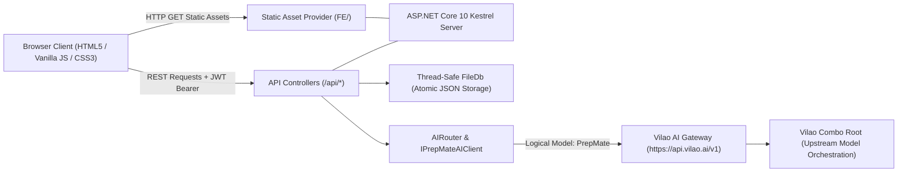

# PrepMate — AI-Powered Multi-Industry Interview Preparation Platform

**PrepMate** is an intelligent, real-time interview preparation platform designed to help job candidates practice technical, situational, and behavioral interviews. The platform pairs candidates with an adaptive AI interviewer persona that deepens questions based on answers, challenges unverified claims, detects cross-turn contradictions, and provides objective diagnostic performance evaluations scored on a **standardized 0–100 point scale**.

---

## 1. Overview
PrepMate bridges the gap between passive interview study and realistic interview pressure across **5 core job families**:
- **Technology & IT:** System architecture, concurrency, microservices, database indexing, and DevOps practices.
- **Marketing & Growth:** Campaign attribution, CAC/LTV analysis, funnel optimization, ROAS, and brand positioning.
- **Finance & Accounting:** Financial forecasting, variance analysis, auditing standards, working capital, and valuation models.
- **Human Resources (HR):** Labor law compliance, conflict resolution, recruitment funnels, eNPS, and retention strategy.
- **Business Analysis (BA):** Requirement elicitation, BPMN workflows, gap analysis, RTM, and stakeholder alignment.

---

## 2. Core Capabilities
- **Interactive Setup Wizard:** 4-step wizard to select job family, seniority level, paste or upload resume (PDF/TXT), set question budgets, and test microphone/camera hardware.
- **Virtual Conference HUD:** Zoom/Teams-style live interview interface featuring real-time webcam video feed, candidate and interviewer tiles, turn-by-turn chat transcript, and countdown timers.
- **Adaptive Conversational AI:** Real-time conversational interview turns via the **Single AI Gateway (`https://api.vilao.ai/v1`)** using logical model alias **`PrepMate`**, featuring contextual follow-up questions, evidence challenges, and supportive unfamiliarity pivots.
- **Evidence-Driven Assessment & Evidence Ledger:** Strict separation between candidate claims and verified facts, preventing cross-turn and cross-session hallucination.
- **Standardized 100-Point Evaluation:** Comprehensive performance evaluation across 6 core competency dimensions, scored and normalized on a unified **0–100 point scale** (`OverallScore`, `TechScore`, `StarScore`, `SituationalScore`, `CandidateQuestionScore`).
- **CV Analysis & Job Recommendations:** Resume parser extracting technical skills and mapping candidates to compatible job requisitions.
- **Personalized Improvement Roadmap:** Structured multi-phase learning roadmap with concrete milestone recommendations.
- **Operations Console:** Comprehensive admin interface for user directories, role permissions, plan management, and live AI provider configuration.

---

## 3. System Architecture
PrepMate is architected as a lightweight, single-tier application where ASP.NET Core Kestrel serves both the backend RESTful API endpoints and the static frontend pages:



---

## 4. Technology Stack & Requirements
- **Backend:** .NET 10.0 (ASP.NET Core Kestrel), C# 13.
- **Node.js (for test runner):** Node.js 18+ (uses zero external npm dependencies; runs on native Node modules).
- **Authentication:** JWT Bearer Token (`Microsoft.AspNetCore.Authentication.JwtBearer`) with PBKDF2 salted password hashing.
- **Data Storage:** `FileDb` (atomic file replacement with in-memory thread synchronization and auto-seeding in development).
- **Frontend:** Zero-framework Vanilla HTML5, CSS3 Custom Properties (Design Tokens), ES6+ JavaScript, Native Web Components.
- **Audio & Video:** Web Speech API (`SpeechRecognition` / `SpeechSynthesis`) and WebRTC (`getUserMedia`).
- **AI Engine:** Single Gateway at `https://api.vilao.ai/v1` targeting logical model alias `PrepMate`.

---

## 5. User Roles & Test Fixture Configuration
PrepMate segregates user privileges across three distinct roles:
- **Candidate:** Access to simulator, practice room, personal history, and report debrief.
- **Manager:** Team overview, candidate session review, and aggregate performance metrics.
- **Admin:** System configuration, user role assignments, subscription overrides, and AI provider settings.

### Test & Development Credentials Setup
For local development and automated E2E testing, configure fixture accounts safely without committing secrets to public repositories:
1. **Automated Testing:** Test runners leverage environment variables with local defaults:
   - Candidate Fixture: `PREPMATE_E2E_EMAIL` and `PREPMATE_E2E_PASSWORD` (configured in local test harness).
   - Admin Fixture: `PREPMATE_ADMIN_EMAIL` and `PREPMATE_ADMIN_PASSWORD`.
2. **Local Development Seeding:** When `BE/data/db.json` is initialized in a fresh development environment, development seed accounts are populated with PBKDF2-hashed credentials. To register a new development account, use the self-service sign-up form at `/features/auth/auth.html` or configure your local environment variables.
3. **Zero Plaintext Secrets:** Plaintext passwords must never be stored in documentation, source code, or shared repositories.

*Detailed permissions matrix available in [`docs/system/USER_ROLES.md`](docs/system/USER_ROLES.md).*

---

## 6. AI Subsystem Architecture & Gateway Integration
PrepMate utilizes an evidence-driven AI interview orchestration layer:
1. **Single AI Gateway:** All AI use cases (interview questions, answer evaluation, CV analysis, career roadmap, report generation) route through `https://api.vilao.ai/v1` with logical model alias `PrepMate`.
2. **Vilao Combo Root:** Upstream fallback between underlying LLM models (e.g. Gemini, GPT-4o, Claude) is managed directly by Vilao's Combo Root. The PrepMate application code interacts exclusively with the `PrepMate` alias without hardcoding provider-specific model IDs.
3. **Evidence Ledger:** Tracks turn-by-turn evidence (`ObservedFacts`, `CandidateClaims`, `Contradictions`, `InformationGaps`). Candidate claims are never converted to verified facts without practical demonstration.
4. **Deterministic Evaluation SSOT:** Final scores and competency ratings are computed deterministically from verified evidence and scaled to the **0–100 point contract**.
5. **No-AI Mode:** If upstream credentials are unavailable or the gateway is offline, PrepMate automatically engages a deterministic fallback mode that preserves the full interview flow without throwing 500 errors.

*Detailed architecture available in [`docs/system/SYSTEM_ARCHITECTURE.md`](docs/system/SYSTEM_ARCHITECTURE.md).*

---

## 7. Project Structure & Module Responsibilities

```text
PrepMate/
├── BE/                                 # ASP.NET Core 10 Web API Backend (.NET 10 / C# 13)
│   ├── Configuration/                  # AIConfiguration.cs, JwtSettings.cs
│   ├── Controllers/                    # REST API Controllers (Auth, AI, Sessions, Admin, etc.)
│   ├── Models/                         # Domain models, Evaluation models, AI DTOs, Session DTOs
│   ├── Prompts/                        # Multi-industry prompts (IT, Finance, HR, Marketing, BA)
│   ├── Services/
│   │   ├── AI/                         # AIRouter, PrepMateAIClient, ComboRootService, ModelRegistry
│   │   ├── Analysis/                   # AdaptiveInterviewEngine, AnswerAnalysisService
│   │   ├── Evaluation/                 # EvidenceReportService, FinalEvaluationService
│   │   ├── Interview/                  # InterviewFlowService, InterviewReportService
│   │   ├── Security/                   # PasswordHasher (PBKDF2), DataProtectionCredentialService
│   │   └── Storage/                    # FileDb (thread-safe JSON store), SessionLockManager
│   ├── Program.cs                      # Kestrel bootstrap, DI registrations, static file serving
│   └── backend.csproj                  # C# project definition
├── FE/                                 # Vanilla HTML5/CSS3/ES6 Frontend
│   ├── features/                       # Feature-based domain modules
│   │   ├── auth/                       # auth.html, auth.js, auth.css (Login/Register/JWT management)
│   │   ├── dashboard/                  # dashboard.html, dashboard.js, new-dashboard.css
│   │   ├── interview/                  # Live interview chamber:
│   │   │   ├── interview-info.html     # Setup wizard & CV upload
│   │   │   ├── interview-practice.html # Live conference HUD
│   │   │   ├── history.html            # Candidate interview history list
│   │   │   └── interview-*.js          # Modular handlers: stt, tts, camera, chat, timer, finish, pause
│   │   ├── report/                     # report.html, report.js, report.css (STAR radar & debrief, 0-100pt)
│   │   ├── admin/                      # admin.html, admin.css, admin-ai-health.js (AI config & ops)
│   │   ├── payment/                    # pricing.html, payment.html
│   │   ├── profile/                    # profile.html, settings.html, cv.html
│   │   └── progress/                   # progress.html (Skills progress & metrics)
│   ├── shared/                         # Shared assets across all pages:
│   │   ├── css/                        # tokens.css (Design tokens), style.css, landing.css
│   │   └── js/                         # main.js (escapeHtml, theme, toast), components.js (Header/Footer)
│   ├── 404.html                        # Fallback error page
│   └── index.html                      # Public landing page & 5-industry simulator
├── scripts/                            # Operational & DevOps utilities
│   └── verify-vilao-key.ps1            # Safe credential verification script (masks secrets)
├── tests/                              # Master Test Framework
│   ├── regression/                     # 16 regression suites (Interview flow, AI config, 100-pt scoring)
│   ├── accessibility/                  # WCAG 2.1 AA compliance checks
│   ├── consistency/                    # Design tokens, iconography, stylesheet extraction tests
│   ├── responsive/                     # Viewport tests (375px mobile to 1024px desktop)
│   ├── e2e/                            # Live cross-industry E2E browser tests (CDP-driven)
│   ├── run-all.js                      # Master regression test runner (22 suites, 665 checks)
│   └── run-e2e.js                      # Live inference and browser E2E test runner
├── docs/                               # Canonical Documentation Catalog
│   ├── deployment/                     # PRODUCTION_DEPLOYMENT_GUIDE.md, CONFIGURATION.md
│   ├── features/                       # ADAPTIVE_INTERVIEW.md, INTERVIEW.md, REPORTING.md
│   ├── system/                         # SYSTEM_ARCHITECTURE.md, DATA_MODEL.md, USER_ROLES.md
│   └── quality/                        # TESTING.md, SECURITY.md, ACCESSIBILITY.md
└── README.md                           # Root onboarding and system reference
```

---

## 8. Quickstart & Local Setup

### 8.1 Prerequisites
- [.NET 10.0 SDK](https://dotnet.microsoft.com/download/dotnet/10.0)
- [Node.js](https://nodejs.org/) (v18 or newer, for automated test runner)
- Modern web browser (Microsoft Edge, Google Chrome, Firefox, or Safari)

### 8.2 Launch the Application
```bash
# 1. From repository root, launch the ASP.NET Core server
dotnet run --project BE/backend.csproj

# The server listens on: http://127.0.0.1:5000 (or http://localhost:5000)
# Both static frontend pages and REST API endpoints (/api/*) are served simultaneously.
```

Open your browser and navigate to:
- **Landing Page:** `http://127.0.0.1:5000/index.html`
- **Candidate Login / Sign-up:** `http://127.0.0.1:5000/features/auth/auth.html` (Register a new local account or log in with your configured development fixture)
- **Admin Console:** `http://127.0.0.1:5000/features/admin/admin.html`

---

## 9. Configuring AI Credentials Safely

PrepMate strictly follows secure credential management principles: **never commit API keys to version control**.

### 9.1 Recommended: Environment Variable
Set `VILAO_API_KEY` in your terminal session or environment:
```powershell
# Windows PowerShell:
$env:VILAO_API_KEY = "your-vilao-api-key-here"
dotnet run --project BE/backend.csproj
```
```bash
# Linux / macOS:
export VILAO_API_KEY="your-vilao-api-key-here"
dotnet run --project BE/backend.csproj
```

### 9.2 Turnkey Verification Utility
Run the included verification script to set and test your credential safely without plaintext logging:
```powershell
powershell -ExecutionPolicy Bypass -File scripts/verify-vilao-key.ps1
```

### 9.3 Admin Console Injection
Alternatively, log in as Admin at `http://127.0.0.1:5000/features/admin/admin.html#settings-tab`, enter your key, and save. Keys stored via the Admin Console are automatically encrypted at rest using **ASP.NET Core Data Protection** (`dp:v1:...`).

---

## 10. Automated Testing

### 10.1 Static Regression Suite (Offline, Fast, CI/CD Baseline)
Executes all 22 test suites completely offline without requiring an active AI key or internet access:
```bash
node tests/run-all.js
```
*Expected Result:* **22 / 22 suites passed, 665 / 665 assertions PASS (100% coverage, ~30s execution time).**

### 10.2 Single Test Suite Execution
Any test suite can be run independently:
```bash
node tests/regression/scoring-standardization.test.js
node tests/regression/interview-flow.test.js
node tests/regression/combo-root-alias.test.js
node tests/accessibility/accessibility.test.js
node tests/responsive/responsive.test.js
```

### 10.3 Live Inference & Browser E2E Test
Runs the full 20-scenario cross-industry benchmark and audits the Analysis/Report page using headless Edge/Chrome over Chrome DevTools Protocol (CDP):
```bash
# Requires VILAO_API_KEY set in environment:
node tests/run-e2e.js
```

---

## 11. Database Integrity & Safety Architecture
- **Production SSOT Database:** Stored at `BE/data/db.json`.
  - Baseline SHA-256 hash: `D2F70C35456A0AA5968DE4FDD6A41E70C08371FF9CC193A69BBD081714A30323`.
  - `BE/data/db.json` is ignored by Git to prevent leaking operational data or committing test mutations.
- **Automatic Development Seeding:** When a developer clones the repository and runs `dotnet run`, `FileDb` automatically detects the absence of `db.json` in Development mode and generates fresh, sanitized seed data with demo accounts.
- **Isolated Testing:** All automated integration and E2E runners execute against isolated test databases in temporary directories (`os.tmpdir()`) via `DATABASE_FILE_PATH`. The production database remains 100% untouched.

---

## 12. Deployment & Production Hardening
For deploying to staging or production environments behind reverse proxies (Nginx, Caddy, Cloudflare, AWS ALB):
- Review the comprehensive guide: **[`docs/deployment/PRODUCTION_DEPLOYMENT_GUIDE.md`](docs/deployment/PRODUCTION_DEPLOYMENT_GUIDE.md)**.
- Topics covered: Same-Domain routing, HTTPS termination, trusted forwarded headers, CORS allowlists, Data Protection key persistence, and health-check monitoring (`/api/admin/ai/health`).

---

## 13. Documentation Catalog
Explore detailed documentation in the `docs/` directory:
- **[System Architecture](docs/system/SYSTEM_ARCHITECTURE.md)** — Architectural components, data flows, and AI routing.
- **[Production Deployment Guide](docs/deployment/PRODUCTION_DEPLOYMENT_GUIDE.md)** — Enterprise deployment, reverse proxy templates, and environment hardening.
- **[Adaptive Interview Engine](docs/features/ADAPTIVE_INTERVIEW.md)** — Conversational state machine and Evidence Ledger.
- **[Testing Framework Guide](docs/quality/TESTING.md)** — Structure of the 22 regression suites and E2E harness.
- **[User Roles & Permissions](docs/system/USER_ROLES.md)** — Access control and permission matrix.
- **[Security Architecture](docs/quality/SECURITY.md)** — Password hashing, JWT token lifecycle, and sanitization.
