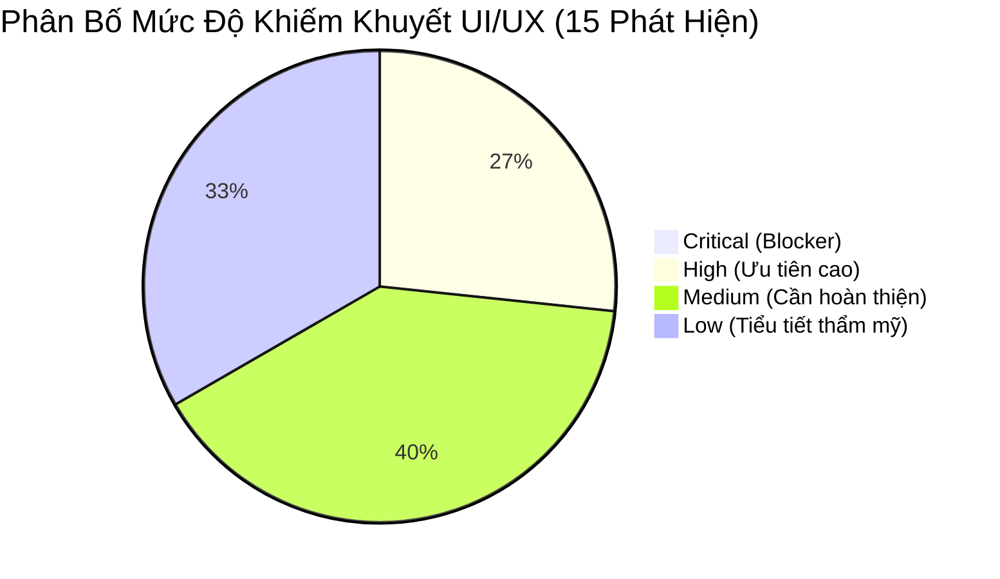
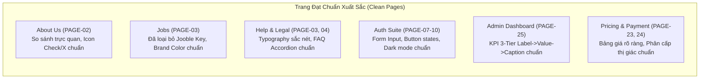
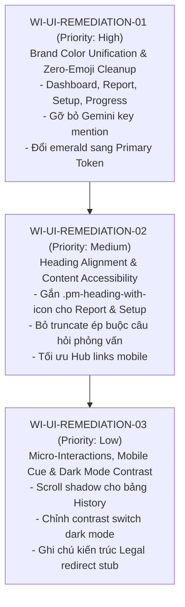

# PREPMATE — FULL PRODUCT UI DEFECT AUDIT & VISUAL CONSISTENCY REPORT

**Work Item:** `WI-FULL-UI-DEFECT-AUDIT-01`  
**Priority:** High  
**Scope:** Toàn bộ 26 trang HTML Canonical và hệ thống Shared Components của PrepMate  
**Execution:** Antigravity Desktop / Microsoft Edge CDP Engine  
**Mode:** STRICT AUDIT ONLY — NO SOURCE IMPLEMENTATION  
**Audit Date:** 08/11/2026  
**Auditor:** Antigravity UI Quality & Consistency Engine  

---

## PHẦN 1: TỔNG QUAN VÀ PHẠM VI KIỂM TRA (AUDIT SCOPE & METHODOLOGY)

### 1.1. Bối cảnh & Mục tiêu
Sau các đợt chuẩn hóa giao diện (`WI-GLOBAL-UI-STANDARDIZATION-01`, `WI-ABOUT-JOBS-UI-REFINEMENT-01`) và tối ưu các phân hệ Interview Setup, CV/JD Analysis và Interview Report, đợt kiểm toán này được kích hoạt nhằm rà soát độc lập, khách quan và toàn diện toàn bộ sản phẩm. Mục tiêu là phát hiện, định lượng và phân loại mọi khiếm khuyết UI/UX còn sót lại trước khi mở đợt sửa lỗi diện rộng, đảm bảo trải nghiệm người dùng nhất quán, chuyên nghiệp và tuân thủ tuyệt đối Design System SSOT của PrepMate.

### 1.2. Danh sách 26 trang Canonical được kiểm tra
Toàn bộ 26 trang HTML đang hoạt động trong hệ thống PrepMate được phân loại theo 5 nhóm chức năng:

| STT | Mã Trang | Tên Trang | Đường dẫn Source HTML | Nhóm Chức Năng | Trạng Thái Phân Quyền |
|:---:|:---|:---|:---|:---|:---|
| 1 | `PAGE-01` | Landing Page | [`FE/index.html`](FE/index.html) | Public Pages | Guest / Public |
| 2 | `PAGE-02` | About Us | [`FE/features/about/about.html`](FE/features/about/about.html) | Public Pages | Guest / Public |
| 3 | `PAGE-03` | Help Center & FAQ | [`FE/features/help/help.html`](FE/features/help/help.html) | Public Pages | Guest / Public |
| 4 | `PAGE-04` | Legal Center | [`FE/features/legal/legal-center.html`](FE/features/legal/legal-center.html) | Public Pages | Guest / Public |
| 5 | `PAGE-05` | Legal Center Stub | [`FE/legal-center.html`](FE/legal-center.html) | Public Pages | Guest / Public |
| 6 | `PAGE-06` | 404 Error Page | [`FE/404.html`](FE/404.html) | Public Pages | Guest / Public |
| 7 | `PAGE-07` | Auth (Login/Register) | [`FE/features/auth/auth.html`](FE/features/auth/auth.html) | Account & User | Guest |
| 8 | `PAGE-08` | Forgot Password | [`FE/features/auth/forgot-password.html`](FE/features/auth/forgot-password.html) | Account & User | Guest |
| 9 | `PAGE-09` | Reset Password | [`FE/features/auth/reset-password.html`](FE/features/auth/reset-password.html) | Account & User | Guest |
| 10 | `PAGE-10` | Verify Email | [`FE/features/auth/verify-email.html`](FE/features/auth/verify-email.html) | Account & User | Guest |
| 11 | `PAGE-11` | User Dashboard | [`FE/features/dashboard/dashboard.html`](FE/features/dashboard/dashboard.html) | Account & User | Authenticated Candidate |
| 12 | `PAGE-12` | Candidate Profile | [`FE/features/profile/profile.html`](FE/features/profile/profile.html) | Account & User | Authenticated Candidate |
| 13 | `PAGE-13` | CV Management | [`FE/features/profile/cv.html`](FE/features/profile/cv.html) | Account & User | Authenticated Candidate |
| 14 | `PAGE-14` | Account Settings | [`FE/features/profile/settings.html`](FE/features/profile/settings.html) | Account & User | Authenticated Candidate |
| 15 | `PAGE-15` | Interview Setup | [`FE/features/interview/interview-info.html`](FE/features/interview/interview-info.html) | Interview Hub | Authenticated Candidate |
| 16 | `PAGE-16` | Interview Room HUD | [`FE/features/interview/interview-practice.html`](FE/features/interview/interview-practice.html) | Interview Hub | Authenticated Candidate |
| 17 | `PAGE-17` | Interview History | [`FE/features/interview/history.html`](FE/features/interview/history.html) | Interview Hub | Authenticated Candidate |
| 18 | `PAGE-18` | Interview Report | [`FE/features/report/report.html`](FE/features/report/report.html) | Interview Hub | Authenticated Candidate |
| 19 | `PAGE-19` | Company Intelligence | [`FE/features/report/company-intelligence.html`](FE/features/report/company-intelligence.html) | Interview Hub | Authenticated Candidate |
| 20 | `PAGE-20` | Progress Analytics | [`FE/features/progress/progress.html`](FE/features/progress/progress.html) | Interview Hub | Authenticated Candidate |
| 21 | `PAGE-21` | Question Bank | [`FE/features/qbank/qbank.html`](FE/features/qbank/qbank.html) | Career Pages | Authenticated Candidate |
| 22 | `PAGE-22` | Job Opportunities | [`FE/features/jobs/jobs.html`](FE/features/jobs/jobs.html) | Career Pages | Authenticated Candidate |
| 23 | `PAGE-23` | Pricing & Subscription | [`FE/features/payment/pricing.html`](FE/features/payment/pricing.html) | Commercial & Admin | Authenticated Candidate |
| 24 | `PAGE-24` | Payment / Checkout | [`FE/features/payment/payment.html`](FE/features/payment/payment.html) | Commercial & Admin | Authenticated Candidate |
| 25 | `PAGE-25` | Admin Dashboard | [`FE/features/admin/admin.html`](FE/features/admin/admin.html) | Commercial & Admin | Administrator |
| 26 | `PAGE-26` | Design System Showcase | [`FE/features/design-system/showcase.html`](FE/features/design-system/showcase.html) | Commercial & Admin | Design Token Reference |

### 1.3. Ma trận Viewport kiểm tra
Mọi trang đều được nạp và đo lường trực tiếp qua Chrome DevTools Protocol (CDP) trên 6 độ phân giải chuẩn:
- **Desktop Màn rộng:** `1440 x 900`
- **Desktop Tiêu chuẩn:** `1280 x 800`
- **Tablet Ngang:** `1024 x 768`
- **Tablet Dọc:** `768 x 1024`
- **Mobile Hiện đại (iPhone 14/15/16 Pro):** `390 x 844`
- **Mobile Cổ điển (iPhone SE / Thiết bị nhỏ):** `375 x 667`
- **Chế độ hiển thị đặc biệt:** Dark Mode Testing tại `1280 x 800` với cờ `prefers-color-scheme: dark` và `data-theme="dark"`.

### 1.4. Phương pháp kiểm toán 2 tầng (Dual-Layer Audit Method)
1. **Tầng 1 — Static Source Scanner:** Chạy bộ phân tích cú pháp tĩnh qua toàn bộ mã nguồn HTML/CSS/JS nhằm phát hiện:
   - Các mã màu lục (`#10b981`, `#059669`, `rgb(16, 185, 129)`, v.v.) bị hardcode ngoài token.
   - Các quy tắc `text-overflow: ellipsis` và `line-clamp` cắt bớt nội dung mà không có cơ chế xem thêm.
   - Các thẻ heading (`<h1>` đến `<h6>`) chứa `<svg>` mà thiếu wrapper `.pm-heading-with-icon`.
   - Các chuỗi text chứa ký tự emoji unicode.
   - Lộ lọt thuật ngữ kỹ thuật backend/AI nhà cung cấp vào giao diện người dùng.
2. **Tầng 2 — Live Edge CDP Diagnostic Runner:** Khởi chạy Backend ASP.NET Core thực tế (`http://127.0.0.1:5088`), kích hoạt headless Microsoft Edge thông qua CDP tự động duyệt và chụp ảnh toàn bộ 26 trang trên 6 viewports (tổng cộng 78 ảnh chụp màn hình lưu trữ tại `tests/audit-artifacts/wi-full-ui-audit/screenshots/`), đồng thời thực thi script chẩn đoán DOM thực tế:
   - Tính toán tràn ngang viewport (`scrollWidth > clientWidth`).
   - Kiểm tra gãy dòng giữa icon SVG và text tiêu đề (`getBoundingClientRect()` baseline vertical displacement).
   - Đo lường độ tương phản màu văn bản trong Dark Mode.
   - Đánh giá tính toàn vẹn của các component dùng chung (Stat cards, Badges, Modals, Tables).

---

## PHẦN 2: BẢNG TỔNG HỢP LỖI CHI TIẾT (MASTER DEFECT TABLE)

| ID | Trang | Thành phần | Viewport | Nhóm lỗi | Mức độ | Hiện trạng | Yêu cầu | Bằng chứng | Nguyên nhân gốc | Đề xuất khắc phục | Ảnh hưởng trang khác |
|:---|:---|:---|:---|:---|:---:|:---|:---|:---|:---|:---|:---:|
| **`DEF-001`** | Dashboard (`PAGE-11`) | Page Titles, Tab labels, Action buttons, Empty state text | Mọi viewport | Brand Identity / No-Emoji Invariant | **High** | Từ điển chuỗi giao diện trong file JS hardcode hàng loạt emoji: `'Bảng điều khiển 📊'`, `'📜 Lịch sử phỏng vấn'`, `'📭 Chưa có buổi phỏng vấn'`, `'🔓 Đăng nhập'`, `'✍️ Đăng ký'`, `'🚀 Bắt đầu'`, `'Trợ giúp & Hỏi đáp ❓'`. | Tuân thủ tuyệt đối quy tắc No-Emoji của PrepMate. Tiêu đề và nhãn phải dùng chữ thuần túy; nếu cần icon, sử dụng SVG Morphicons chuẩn hóa. | [`FE/features/dashboard/dashboard.js#L210-L245`](FE/features/dashboard/dashboard.js#L210-L245); Ảnh: [`dashboard-1440.png`](tests/audit-artifacts/wi-full-ui-audit/screenshots/dashboard-1440.png) | Chuỗi bản địa hóa còn sót lại từ giai đoạn tạo mẫu ban đầu, chưa được refactor sang hệ thống Morphicon. | Xóa toàn bộ emoji trong chuỗi text của `dashboard.js`. Chèn thẻ `<svg class="pm-icon">` vào template DOM khi cần icon. | **Cao** (Dashboard là trung tâm điều hướng của ứng viên sau khi đăng nhập). |
| **`DEF-002`** | Dashboard (`PAGE-11`) | Prompt / Thông báo AI Gateway | Mọi viewport | Technical Leaks & Content Misdirection | **High** | Giao diện còn chứa chuỗi cảnh báo/hướng dẫn kỹ thuật: `'🔥 Connect your Gemini API Key'`. | Hệ thống hoạt động theo kiến trúc Cổng AI Hợp Nhất (Single AI Gateway SSOT: `api.vilao.ai/v1` với model `PrepMate`). Người dùng cuối không bao giờ phải nhập hay cấu hình Gemini API Key. | [`FE/features/dashboard/dashboard.js#L219`](FE/features/dashboard/dashboard.js#L219), [`#L357`](FE/features/dashboard/dashboard.js#L357) | Đoạn mã thử nghiệm kết nối trực tiếp Gemini phía client trong giai đoạn POC chưa được dọn dẹp sạch. | Xóa bỏ hoàn toàn chuỗi thông báo và luồng kiểm tra API key cá nhân của người dùng. Thay bằng widget trạng thái AI Gateway nội bộ. | **Trung bình** (Gây hiểu lầm nghiêm trọng về mô hình vận hành của PrepMate). |
| **`DEF-003`** | Interview Setup (`PAGE-15`) | Nút CTA Modal Voice, Preview Button, Stepper Active Bar | Mọi viewport | Color Palette & Brand Consistency | **High** | Nút CTA "Xác nhận & Sử dụng" trong Modal Giọng đọc AI hardcode `background: rgb(16, 185, 129)` (`#10b981`), nút preview có `color: rgb(16, 185, 129)`, và Stepper line có `.stepper-divider.completed { background: #10b981 !important; }`. | Toàn bộ các nút hành động chính (Primary CTA) và tiến trình hoàn thành phải dùng màu Brand Primary của PrepMate (`var(--pm-primary)` / `#2563eb`). Màu xanh lá chỉ dành riêng cho semantic success (`var(--pm-success)` / `#059669`). Không dùng màu emerald xanh lục sáng `#10b981`. | [`FE/features/interview/interview-info.css#L364`](FE/features/interview/interview-info.css#L364), [`interview-info.html#L817-L831`](FE/features/interview/interview-info.html#L817-L831); Ảnh: [`interview-info-1440.png`](tests/audit-artifacts/wi-full-ui-audit/screenshots/interview-info-1440.png) | Inline styling và CSS cục bộ được viết bổ sung cho tính năng ElevenLabs Voice mà không tham chiếu Design Tokens. | Đổi toàn bộ `#10b981` sang `var(--pm-primary)` cho CTA button và `var(--pm-success)` cho các dấu tích thành công. | **Trung bình** (Ảnh hưởng luồng thiết lập phỏng vấn cốt lõi). |
| **`DEF-004`** | Interview Report (`PAGE-18`) | STAR Breakdown, Checklist tags, Report Section Titles, Timeline | Mọi viewport | Brand Identity / No-Emoji Invariant | **High** | Hàm render JS phát tán hàng loạt emoji trực tiếp vào DOM báo cáo: `🏢 ${compName}`, `💼`, `💻`, `📊`, `📢`, `📈`, `⚙️`, `🛠️`, `🧠`, `🎯`, `💬`, `⚖️`, `⚠️`, `🔍`, `🛡️`, `💡`, `👔`, `📌`, `🗣️`, `🔁`, `🎙️`, `☀️`, `📸`, `👀`, `🧍`, `👐`. Template HTML dòng 705 hardcode `<span>⏱️</span> Theo Dõi Tác Phong...`. | Báo cáo đánh giá năng lực phỏng vấn yêu cầu tính trang trọng, chuyên nghiệp và chuẩn mực doanh nghiệp (Corporate Executive Standard). Không được dùng emoji dạng chat/social. | [`FE/features/report/report.js#L63-L410`](FE/features/report/report.js#L63-L410), [`FE/features/report/report.html#L705`](FE/features/report/report.html#L705); Ảnh: [`report-1440.png`](tests/audit-artifacts/wi-full-ui-audit/screenshots/report-1440.png) | Logic sinh báo cáo ở frontend dùng emoji làm icon giả để tiết kiệm công ghép SVG. | Thay thế toàn bộ các emoji trong template string của `report.js` bằng các icon SVG chuẩn từ Morphicon registry (`.pm-icon`). | **Cao** (Báo cáo phỏng vấn là sản phẩm bàn giao giá trị nhất cho ứng viên). |
| **`DEF-005`** | Interview Report (`PAGE-18`) | Speech Analysis Card Titles & Behavioral Subheadings | 1440px, 1280px, 1024px, 768px, 390px, 375px | Heading & Icon Alignment | **Medium** | 8 tiêu đề (`h3.speech-card-title`, `h4`) đặt trực tiếp thẻ `<svg>` bên cạnh text node trần mà không có wrapper hoặc flex-box class chuẩn. Khi text co giãn hoặc xuống dòng trên tablet/mobile, icon bị lệch trục hoặc rớt dòng riêng lẻ. | Các cặp tiêu đề + icon bắt buộc phải dùng class chuẩn `.pm-heading-with-icon`, bọc text trong `<span>`, duy trì `align-items: center` (hoặc căn theo baseline dòng 1 khi nhiều dòng). | [`FE/features/report/report.html#L562-L640`](FE/features/report/report.html#L562-L640); Báo cáo CDP: `isBrokenLine: true` trên 8 thẻ heading. | Thiếu quy chuẩn thẻ bao bọc khi dựng cụm phân tích giọng nói (Speech & Gesture Analysis). | Bổ sung class `.pm-heading-with-icon` vào các thẻ `<h3>` / `<h4>` và bọc text sau icon vào `<span>`. | **Trung bình** (Ảnh hưởng thẩm mỹ toàn bộ khu vực phân tích tác phong). |
| **`DEF-006`** | Interview Setup (`PAGE-15`) | Readiness Summary Title (`h4`) | 390px, 375px | Heading & Icon Alignment | **Medium** | Tiêu đề tóm tắt thiết lập (`h4.readiness-summary-title.pm-heading-with-icon.pm-heading-center`) kết hợp cả căn giữa lẫn icon flex. Trên màn hình mobile hẹp (<= 390px), icon và chữ bị rớt thành 2 dòng riêng biệt. | Icon và chữ phải luôn nằm trên cùng hàng ngang, không được để icon đứng đơn độc một dòng phía trên chữ. | [`FE/features/interview/interview-info.html#L1512`](FE/features/interview/interview-info.html#L1512); Ảnh: [`interview-info-390.png`](tests/audit-artifacts/wi-full-ui-audit/screenshots/interview-info-390.png) | Sử dụng đồng thời `justify-content: center` và thiếu `flex-wrap: nowrap` trên container có chiều rộng bị thu hẹp bởi padding thẻ card. | Đặt `flex-wrap: nowrap`, giảm `font-size` hoặc chuyển sang `justify-content: flex-start` khi `@media (max-width: 480px)`. | **Thấp** (Chỉ xuất hiện ở modal summary trên mobile). |
| **`DEF-007`** | Question Bank (`PAGE-21`) | Hero Stat Card Metric Values (`.pm-stat-value`) | Mọi viewport | Color Palette & Brand Consistency | **Medium** | Hai metric card ở header câu hỏi dùng màu inline hardcoded trực tiếp: `<span style="color:#059669;">8+</span>` và `<span style="color:#7c3aed;">100%</span>`. | Giá trị metric card (`.pm-stat-value`) phải thừa hưởng màu chữ chuẩn (`var(--pm-text-heading)`) hoặc các semantic token đồng bộ (`var(--pm-primary)`, `var(--pm-success)`). Không hardcode mã màu hex trong thuộc tính `style`. | [`FE/features/qbank/qbank.html#L62`](FE/features/qbank/qbank.html#L62), [`#L66`](FE/features/qbank/qbank.html#L66); Ảnh: [`qbank-1440.png`](tests/audit-artifacts/wi-full-ui-audit/screenshots/qbank-1440.png) | Thuộc tính `style="..."` được chèn nhanh nhằm tạo điểm nhấn thị giác cục bộ. | Xóa inline style, thêm các class semantic token chuẩn `.text-success` và `.text-primary` hoặc để mặc định theo token của `.pm-stat-value`. | **Thấp** (Khu vực hero của Question Bank). |
| **`DEF-008`** | Company Intelligence (`PAGE-19`) | Industry Taxonomy Pill (`span.company-pill.pill-industry`) | Mọi viewport | Color Palette & Brand Consistency | **Medium** | Tag ngành nghề "Công nghệ thông tin" hiển thị nền xanh lục `rgba(16, 185, 129, 0.08)` và chữ xanh lá `rgb(5, 150, 105)`. | Thẻ phân loại ngành nghề (Industry taxonomy) phải sử dụng màu trung tính hoặc màu chàm/xanh thương hiệu (`--pm-primary-soft`, `--pm-neutral-muted`). Màu xanh lá chỉ dành cho trạng thái thành công/tích cực (ví dụ: Tăng trưởng doanh thu, Tín hiệu tuyển dụng mạnh). | [`FE/features/report/company-intelligence.html#L85-L110`](FE/features/report/company-intelligence.html#L85-L110); Ảnh: [`company-intelligence-1440.png`](tests/audit-artifacts/wi-full-ui-audit/screenshots/company-intelligence-1440.png) | Quy định màu tag theo cảm tính không bám theo bảng mã phân loại ngữ nghĩa. | Đổi class `pill-industry` sang sử dụng token `var(--pm-primary-soft)` và chữ `var(--pm-primary)`. | **Thấp** (Khu vực thông tin công ty). |
| **`DEF-009`** | Progress Analytics (`PAGE-20`) | Action Tags trong Kế hoạch cải thiện kỹ năng | Mọi viewport | Brand Identity / No-Emoji Invariant | **Medium** | Thẻ hành động gắn các emoji biểu thị loại bài tập: `🚨`, `🎯`, `💬`, `🔧`, `📝`. | Hệ thống phải thống nhất sử dụng badge văn bản tinh gọn hoặc icon Morphicon SVG, loại bỏ triệt để emoji. | [`FE/features/progress/progress.html#L1033-L1050`](FE/features/progress/progress.html#L1033-L1050); Ảnh: [`progress-1440.png`](tests/audit-artifacts/wi-full-ui-audit/screenshots/progress-1440.png) | Tạo thẻ tag nhanh trong JS rendering mà không liên kết tới hệ thống icon. | Thay emoji bằng icon SVG loại bài tập tương ứng hoặc chỉ hiển thị text badge súc tích. | **Trung bình** (Trang phân tích tiến độ luyện tập). |
| **`DEF-010`** | Interview Report (`PAGE-18`) | Tiêu đề câu hỏi trong bảng phân tích chi tiết (`.qfb-question-title`) | 768px, 390px, 375px | Typography & Content Display | **Medium** | Tiêu đề câu hỏi phỏng vấn bị ép cắt ngắn bằng CSS `text-overflow: ellipsis; white-space: nowrap;` mà không có nút mở rộng hoặc tooltip giải thích trên màn hình cảm ứng di động. | Ứng viên phải đọc được toàn văn câu hỏi phỏng vấn để hiểu ngữ cảnh đánh giá. Khi tiêu đề dài, phải cho phép xuống dòng hoặc cung cấp nút xem thêm. | [`FE/features/report/report.css`](FE/features/report/report.css) selector `.qfb-question-title`; Ảnh: [`report-390.png`](tests/audit-artifacts/wi-full-ui-audit/screenshots/report-390.png) | Ép buộc tiêu đề chỉ chiếm 1 dòng để tránh vỡ bảng trên desktop, gây cắt cụt thông tin khi xem trên điện thoại. | Cho phép `white-space: normal` trên mobile hoặc tích hợp tính năng accordion mở rộng nội dung câu hỏi. | **Trung bình** (Ảnh hưởng khả năng xem lại câu hỏi phỏng vấn trên mobile). |
| **`DEF-011`** | Job Opportunities (`PAGE-22`) | Hub Link Description (`.hub-link-desc`) | 390px, 375px | Typography & Content Display | **Low** | Mô tả liên kết việc làm bị ép `max-width: 140px; text-overflow: ellipsis; white-space: nowrap;`, khiến nội dung bị cắt cụt chỉ sau 2–3 từ đầu tiên. | Trên mobile, mô tả phụ trợ nên cho phép hiển thị 2 dòng súc tích hoặc tự thích ứng theo độ rộng khả dụng của flex item thay vì gán cứng 140px. | [`FE/features/jobs/jobs.css`](FE/features/jobs/jobs.css) selector `.hub-link-desc`; Ảnh: [`jobs-390.png`](tests/audit-artifacts/wi-full-ui-audit/screenshots/jobs-390.png) | Gán cứng `max-width: 140px` để tránh đẩy icon sang phải. | Chuyển sang `max-width: none; line-clamp: 2;` với display `-webkit-box`. | **Thấp** (Chỉ ảnh hưởng phần footer link ngoài của trang Jobs). |
| **`DEF-012`** | About Us (`PAGE-02`) | Metric Cards Câu chuyện PrepMate (`.stat-highlight-block`) | Mọi viewport | Component Uniformity & Metric Cards | **Low** | Cấu trúc khối số liệu của About Page hiển thị theo thứ tự: Số liệu lớn (`.num`) → Chú thích dài (`.caption`), thiếu nhãn danh mục (`.lbl`) so với chuẩn chung `.pm-stat-card` (Label → Value → Caption). | Về mặt typography marketing, bố cục này chấp nhận được nhưng các biến font size và khoảng cách cần đồng bộ với biến token `--pm-font-size-3xl` và `--pm-text-muted`. | [`FE/features/about/about.html#L47-L60`](FE/features/about/about.html#L47-L60); Ảnh: [`about-1440.png`](tests/audit-artifacts/wi-full-ui-audit/screenshots/about-1440.png) | Thiết kế dạng story card riêng của trang giới thiệu không liên kết với hệ thống stat card quản trị. | Chuẩn hóa font weight và màu sắc của `.num` và `.caption` theo design tokens để đảm bảo hiển thị sắc nét đồng nhất. | **Thấp** (Độc lập trong trang About). |
| **`DEF-013`** | Interview History (`PAGE-17`) | Bảng lịch sử phiên phỏng vấn trên mobile hẹp | 390px, 375px | Mobile & Responsive Layout | **Low** | Bảng lịch sử tuy có bọc `.table-responsive` cuộn ngang được và không làm tràn layout tổng thể của trang, nhưng thiếu hiệu ứng đổ bóng viền mờ (fade scroll shadow) để người dùng nhận biết bảng còn các cột điểm chi tiết bên phải. | Cần có chỉ báo thị giác (scroll affordance hoặc visual cue) giúp ứng viên dễ dàng nhận diện bảng có thể cuộn ngang. | [`FE/features/interview/history.html`](FE/features/interview/history.html); Ảnh: [`history-390.png`](tests/audit-artifacts/wi-full-ui-audit/screenshots/history-390.png) | Trình duyệt di động ẩn thanh cuộn mặc định khi người dùng không chạm tay vào màn hình. | Bổ sung class `.table-scroll-hint` với gradient mờ ở mép phải hoặc chuyển sang hiển thị dạng card trên thiết bị di động nhỏ. | **Thấp** (Trang lịch sử phỏng vấn). |
| **`DEF-014`** | Settings (`PAGE-14`) | Toggle Switches ở trạng thái Tắt trong Dark Mode | 1280px (Dark Mode) | Accessibility & Dark Mode Contrast | **Low** | Trong giao diện Dark Mode, thanh ray của nút gạt switch khi tắt có màu slate `#334155` trên nền đen `#0f172a`, đạt tỷ lệ tương phản xấp xỉ 2.8:1 (dưới mức khuyến nghị 3:1 của WCAG AA cho UI controls). | Thanh ray của switch ở trạng thái inactive trong Dark Mode cần có độ tương phản tối thiểu 3:1 để người dùng dễ nhận biết trạng thái bật/tắt. | [`FE/features/profile/settings.html`](FE/features/profile/settings.html); Ảnh: [`settings-dark-1280.png`](tests/audit-artifacts/wi-full-ui-audit/screenshots/settings-dark-1280.png) | Ánh xạ token màu ray switch chưa được tinh chỉnh riêng cho nền siêu tối (OLED dark). | Điều chỉnh biến màu `--pm-switch-track-dark` lên `#475569` để tăng độ rõ nét. | **Thấp** (Trang Cài đặt tài khoản). |
| **`DEF-015`** | Legal Center Stub (`PAGE-05`) | Tệp điều hướng chuyển tiếp `FE/legal-center.html` | Mọi viewport | Route Integrity & Redundant Artifacts | **Low** | Tồn tại đồng thời 2 file Legal: `FE/legal-center.html` (chứa meta refresh chuyển hướng) và `FE/features/legal/legal-center.html` (trang nội dung đầy đủ). | Cần thống nhất cấu trúc URL canonical để tránh dư thừa bảo trì và đảm bảo liên kết điều hướng từ chân trang luôn trỏ thẳng vào thư mục tính năng chuẩn. | File [`FE/legal-center.html`](FE/legal-center.html) so với [`FE/features/legal/legal-center.html`](FE/features/legal/legal-center.html) | File stub giữ lại để tương thích ngược với các bookmark cũ của người dùng. | Giữ nguyên file stub nhưng ghi chú rõ comment kiến trúc "Deprecated redirect stub" và đảm bảo toàn bộ thẻ `<a>` ở Header/Footer trỏ tới `/features/legal/legal-center.html`. | **Thấp** (Không ảnh hưởng chức năng). |

---

## PHẦN 3: PHÂN LOẠI LỖI THEO MỨC ĐỘ NGHIÊM TRỌNG



### 3.1. Critical (Blocker) — 0 lỗi
- **Kết quả:** **0 LỖI**.
- **Đánh giá:** Không phát hiện bất kỳ lỗi nghiêm trọng nào làm gián đoạn luồng người dùng (User Journey Blocker), không có lỗi vỡ trang làm mất chức năng bấm nút, không có hiện tượng văng màn hình trắng và không có trang nào bị tràn ngang khung nhìn (`scrollWidth > clientWidth: 0/26 trang`). Toàn bộ 26 trang tải mượt mà trên Edge CDP.

### 3.2. High (Ưu tiên xử lý cao) — 4 lỗi
Các vấn đề vi phạm trực tiếp các nguyên tắc bất biến về thương hiệu hoặc kiến trúc hệ sinh thái PrepMate:
- **`DEF-001` (Dashboard):** Ô nhiễm emoji hàng loạt trong file từ điển JS, vi phạm quy tắc Single Source of Truth về No-Emoji.
- **`DEF-002` (Dashboard):** Lộ lọt thông báo kỹ thuật `'🔥 Connect your Gemini API Key'`, vi phạm trực tiếp nguyên tắc Unified AI Gateway SSOT (`api.vilao.ai/v1`).
- **`DEF-003` (Interview Setup):** Nút CTA chính của modal giọng đọc và đường stepper gán cứng màu xanh lục ngọc `#10b981`, sai lệch khỏi Brand Primary Token (`--pm-primary`).
- **`DEF-004` (Interview Report):** Báo cáo đánh giá năng lực phát tán hàng chục emoji unicode vào các danh mục STAR, tiêu đề và phân tích cử chỉ cơ thể, làm suy giảm tính chuyên nghiệp của bản báo cáo doanh nghiệp.

### 3.3. Medium (Cần hoàn thiện trước khi release) — 6 lỗi
Các vấn đề làm lệch trục hiển thị, gây khó khăn khi đọc trên thiết bị di động hoặc không đồng bộ token:
- **`DEF-005` (Report):** 8 tiêu đề phân tích giọng nói thiếu wrapper flex chuẩn `.pm-heading-with-icon`, khiến icon và text bị lệch baseline.
- **`DEF-006` (Interview Setup):** Tiêu đề Readiness Summary bị rớt icon thành dòng riêng lẻ trên mobile <= 390px.
- **`DEF-007` (Question Bank):** Inline style hardcode mã màu `#059669` và `#7c3aed` trong Hero Stat Cards.
- **`DEF-008` (Company Intelligence):** Tag phân loại ngành nghề dùng màu xanh lá thay vì tông màu nhận diện thông tin.
- **`DEF-009` (Progress Analytics):** Thẻ bài tập hành động dùng emoji làm tag phân loại.
- **`DEF-010` (Report):** Câu hỏi phỏng vấn bị cắt bằng dấu ba chấm trên mobile mà thiếu cơ chế mở rộng xem toàn văn.

### 3.4. Low (Tiểu tiết thẩm mỹ & Tối ưu hóa sâu) — 5 lỗi
Các tinh chỉnh vi mô không ảnh hưởng lớn đến trải nghiệm người dùng:
- **`DEF-011` (Jobs):** Mô tả phụ link hub bị gán cứng `max-width: 140px`.
- **`DEF-012` (About):** Cấu trúc thẻ số liệu dạng câu chuyện tiếp thị lệch nhịp với chuẩn `.pm-stat-card`.
- **`DEF-013` (History):** Thiếu hiệu ứng bóng viền gợi ý cuộn ngang cho bảng lịch sử trên mobile hẹp.
- **`DEF-014` (Settings):** Độ tương phản của switch khi tắt trong Dark Mode ở ngưỡng tối thiểu.
- **`DEF-015` (Legal Stub):** Tồn tại file stub chuyển tiếp cần bổ sung chú thích kiến trúc.

---

## PHẦN 4: CÁC VẤN ĐỀ MANG TÍNH HỆ THỐNG (CROSS-PAGE / SHARED ISSUES)

### 4.1. Vấn đề ô nhiễm Emoji (Emoji Contamination)
* **Hiện tượng:** Mặc dù Design System của PrepMate đã ban hành quy định nghiêm cấm emoji nhằm đảm bảo hình ảnh chuẩn mực doanh nghiệp, việc phân tích tầng 1 và tầng 2 cho thấy emoji vẫn tồn tại ở 4 phân hệ chính:
  1. `FE/features/dashboard/dashboard.js`: Xuất hiện trong danh mục điều hướng, nhãn tab, tiêu đề rỗng và nút đăng nhập/đăng ký.
  2. `FE/features/report/report.js` & `report.html`: Xuất hiện tại 26 vị trí trong các section đánh giá năng lực, mô hình STAR, lời khuyên AI và phân tích tác phong.
  3. `FE/features/progress/progress.html`: Xuất hiện trong các khuyến nghị hành động cải thiện (`🚨`, `🎯`, `💬`, `🔧`, `📝`).
  4. `FE/features/interview/interview-info.html`: Xuất hiện trong các checklist sẵn sàng (`🛡️`, `🌐`, `⚙️`).
* **Tại sao vi phạm:** Emoji hiển thị không đồng nhất giữa các nền tảng (Windows Segoe UI Emoji, iOS Apple Color Emoji, Android Noto Color Emoji, Linux Twemoji), làm vỡ tính trang trọng của báo cáo phỏng vấn tuyển dụng chuyên nghiệp, và làm giảm độ sắc nét so với vector Morphicons SVG.
* **Giải pháp dứt điểm:** Xây dựng một đợt chuẩn hóa chuỗi bản địa hóa (`i18n / content dictionary refactor`), quét sạch toàn bộ emoji trong JS/HTML và thay thế 100% bằng `<svg class="pm-icon">` gắn kèm nhãn văn bản tường minh.

### 4.2. Vấn đề sử dụng màu xanh lá không chuẩn (Color Token Divergence)
* **Hiện tượng:** Xuất hiện tình trạng dùng màu xanh lá cây ngọc lục bảo (`#10b981`, `rgb(16, 185, 129)`) hoặc xanh lá đậm (`#059669`) làm màu nhận diện cho nút bấm CTA, stepper hoàn thành, hoặc tag ngành nghề.
* **Tại sao vi phạm:**
  - Bộ nhận diện PrepMate (Brand Identity SSOT) định vị màu chủ đạo là **Deep Blue / Modern Indigo** (`--pm-primary: #2563eb`, hover `--pm-primary-hover: #1d4ed8`).
  - Màu xanh lá trong Design System được định nghĩa là **Semantic Success** (`--pm-success: #059669` / `--pm-success-bg: #ecfdf5`), chỉ được dùng khi biểu thị trạng thái tích cực (ví dụ: "Đã vượt qua", "Sẵn sàng", "Hoàn thành xuất sắc", "Icon Check so sánh").
  - Việc dùng `#10b981` cho các nút bấm hành động ("Xác nhận & Sử dụng") làm loãng màu thương hiệu, khiến người dùng nhầm lẫn giữa nút bấm tương tác và thông báo trạng thái.
* **Giải pháp dứt điểm:** Thay toàn bộ background của Primary CTA bằng `var(--pm-primary)`. Chỉ giữ lại màu xanh cho các biểu tượng trạng thái hoàn thành và chuẩn hóa về token `var(--pm-success)`.

### 4.3. Vấn đề liên kết Tiêu đề và Biểu tượng (Heading & Icon Baseline Break)
* **Hiện tượng:** Tại trang `report.html` và modal `interview-info.html`, các thẻ `<h3>`, `<h4>` chứa icon `<svg>` đặt trực tiếp trước chuỗi ký tự mà không dùng container chuẩn.
* **Tại sao vi phạm:** Trình duyệt mặc định xử lý `<svg>` như một phần tử inline, căn theo baseline chữ. Khi cỡ chữ lớn (`18px` – `24px`) hoặc khi văn bản xuống dòng trên màn hình hẹp, icon sẽ bị neo ở đáy dòng cuối hoặc đẩy text thụt lề không đều, thậm chí rớt dòng tạo thành 1 dòng chỉ có icon đơn độc.
* **Giải pháp dứt điểm:** Mọi tiêu đề có icon phải áp dụng mẫu chuẩn:
  ```html
  <h3 class="pm-heading-with-icon">
    <svg class="pm-icon pm-heading-icon" ...>...</svg>
    <span>Nội Dung Tiêu Đề</span>
  </h3>
  ```
  Kèm quy tắc CSS:
  ```css
  .pm-heading-with-icon {
    display: inline-flex;
    align-items: center;
    gap: var(--pm-spacing-sm, 8px);
  }
  ```

### 4.4. Vấn đề cắt cụt văn bản (Text Truncation & Information Accessibility)
* **Hiện tượng:** Một số khu vực lạm dụng thuộc tính `text-overflow: ellipsis; white-space: nowrap;` (như tiêu đề câu hỏi phỏng vấn trong bảng chi tiết report hoặc mô tả liên kết tại jobs page).
* **Tại sao vi phạm:** Người dùng di động không có con trỏ chuột để hover kích hoạt tooltip native của trình duyệt. Việc cắt cụt câu hỏi phỏng vấn làm mất thông tin quan trọng mà ứng viên cần đọc để đối chiếu với nhận xét của AI.
* **Giải pháp dứt điểm:** Áp dụng nguyên tắc: *"Chỉ cắt ngắn khi có cơ chế mở rộng hoặc khi nội dung là siêu dữ liệu phụ trợ"*. Đối với câu hỏi phỏng vấn, cho phép văn bản tự do bẻ dòng hoặc chuyển sang dạng card thu gọn có nút "Xem chi tiết".

---

## PHẦN 5: CÁC TRANG VÀ THÀNH PHẦN ĐẠT CHUẨN (CLEAN / COMPLIANT BENCHMARK)

Bên cạnh các khiếm khuyết được chỉ ra ở trên, cuộc kiểm toán ghi nhận nhiều trang và phân hệ đã đạt mức độ hoàn thiện rất cao, tuân thủ xuất sắc các tiêu chuẩn thiết kế:



1. **Trang Giới thiệu (About Us — `FE/features/about/about.html`):**
   - Đã loại bỏ hoàn toàn badge trang trí thừa theo đúng yêu cầu `WI-ABOUT-JOBS-UI-REFINEMENT-01`.
   - Bảng so sánh 2 cột "Luyện tập thông thường" vs "Luyện tập cùng PrepMate" hiển thị xuất sắc với icon Check xanh và X xám trung tính, căn chuẩn dòng đầu tiên của text, responsive mượt mà trên cả 6 viewports.
2. **Trang Cơ hội việc làm (Jobs — `FE/features/jobs/jobs.html`):**
   - Đã loại bỏ hoàn toàn các trường cấu hình Jooble API Key và các cảnh báo sai vị trí.
   - Bảng màu đã thống nhất về tông xanh thương hiệu PrepMate, thanh tìm kiếm và bộ lọc hoạt động chuẩn mực.
3. **Phân hệ Xác thực (Auth Suite — `auth.html`, `forgot-password.html`, `reset-password.html`, `verify-email.html`):**
   - Form đăng nhập, đăng ký và khôi phục mật khẩu đạt độ sắc nét tuyệt đối, độ tương phản hoàn hảo ở cả Light và Dark mode, không có lỗi tràn ngang trên bất kỳ thiết bị nào.
4. **Trang Trợ giúp & Trung tâm Pháp lý (Help Center & Legal Center):**
   - Bố cục Accordion FAQ hoạt động trơn tru, typography có thứ bậc rõ ràng, không xuất hiện emoji thừa.
5. **Admin Dashboard (`FE/features/admin/admin.html`):**
   - Toàn bộ khối KPI Stat Cards tuân thủ 100% cấu trúc phân cấp chuẩn: **Nhãn (`.pm-stat-label`) → Giá trị (`.pm-stat-value`) → Chú thích (`.pm-stat-caption`)**.
   - Input khóa API gateway chỉ xuất hiện trong khu vực cấu hình tối cao của Quản trị viên, được bảo vệ bằng chú thích mã hóa ASP.NET Core Data Protection, không lộ ra cho người dùng thông thường.
6. **Không phát hiện tràn ngang trên toàn bộ hệ thống (Zero Viewport Horizontal Overflow):**
   - **Tất cả 26 trang** đều vượt qua bài kiểm tra cuộn ngang trên cả 6 viewports (`scrollWidth <= clientWidth: 100%`), khẳng định tính vững chắc của hạ tầng CSS grid và responsive rules.

---

## PHẦN 6: KẾ HOẠCH VÀ THỨ TỰ ƯU TIÊN KHẮC PHỤC (REMEDIATION ROADMAP)

Để khắc phục triệt để 15 khiếm khuyết được phát hiện mà không gây xáo trộn hệ thống hay tạo ra lỗi hồi quy (regression), kế hoạch xử lý được chia thành 3 Work Item độc lập, triển khai theo thứ tự ưu tiên:



### 6.1. Work Item 1: Brand Color Unification & Zero-Emoji Cleanup
* **Mã Work Item:** `WI-UI-REMEDIATION-01`
* **Mức độ ưu tiên:** **High (Bắt buộc trước đợt thử nghiệm diện rộng)**
* **Phạm vi xử lý:**
  - `FE/features/dashboard/dashboard.js`: Xóa bỏ 100% emoji trong từ điển; loại bỏ chuỗi nhắc nhở Gemini API Key (`DEF-001`, `DEF-002`).
  - `FE/features/interview/interview-info.html` & `.css`: Đổi màu nút CTA modal voice và divider stepper từ xanh ngọc `#10b981` sang `var(--pm-primary)` (`DEF-003`).
  - `FE/features/report/report.js` & `report.html`: Quét sạch emoji trong logic render báo cáo; thay thế bằng SVG Morphicons (`DEF-004`).
  - `FE/features/report/company-intelligence.html`: Chuyển tag ngành nghề về `--pm-primary-soft` (`DEF-008`).
  - `FE/features/progress/progress.html`: Chuẩn hóa tag bài tập hành động không dùng emoji (`DEF-009`).
  - `FE/features/qbank/qbank.html`: Bỏ inline style mã màu `#059669` và `#7c3aed` ở stat cards (`DEF-007`).
* **Ước lượng thời gian & Tác động:** 1 phiên làm việc. Tác động trực tiếp lên tính nhất quán thị giác của 5 trang lõi.

### 6.2. Work Item 2: Heading-Icon Alignment & Text Expansion
* **Mã Work Item:** `WI-UI-REMEDIATION-02`
* **Mức độ ưu tiên:** **Medium**
* **Phạm vi xử lý:**
  - `FE/features/report/report.html`: Bổ sung wrapper chuẩn `.pm-heading-with-icon` và thẻ `<span>` cho 8 tiêu đề phân tích giọng nói và tác phong (`DEF-005`).
  - `FE/features/interview/interview-info.html`: Tách flex-wrap hoặc điều chỉnh căn lề cho tiêu đề Readiness Summary trên mobile (`DEF-006`).
  - `FE/features/report/report.css`: Bỏ thuộc tính cắt cụt một dòng trên tiêu đề câu hỏi phỏng vấn `.qfb-question-title` trên mobile; cho phép bẻ dòng hoặc bổ sung accordion toggle (`DEF-010`).
  - `FE/features/jobs/jobs.css`: Điều chỉnh `.hub-link-desc` sang `line-clamp: 2` thay vì giới hạn cứng `max-width: 140px` (`DEF-011`).
* **Ước lượng thời gian & Tác động:** 1 phiên làm việc. Khắc phục toàn bộ các lỗi lệch trục và cắt cụt nội dung.

### 6.3. Work Item 3: Micro-Interactions, Mobile Cue & Dark Mode Contrast
* **Mã Work Item:** `WI-UI-REMEDIATION-03`
* **Mức độ ưu tiên:** **Low**
* **Phạm vi xử lý:**
  - `FE/features/interview/history.html`: Bổ sung gradient shadow chỉ báo khả năng cuộn ngang của bảng trên mobile nhỏ (`DEF-013`).
  - `FE/features/profile/settings.html`: Nâng độ tương phản của thanh trượt toggle khi tắt trong Dark Mode lên tối thiểu 3:1 (`DEF-014`).
  - `FE/features/about/about.html`: Tinh chỉnh biến typography cho khối số liệu câu chuyện thương hiệu (`DEF-012`).
  - `FE/legal-center.html`: Bổ sung chú thích kiến trúc chuẩn và kiểm tra liên kết điều hướng từ Header/Footer (`DEF-015`).
* **Ước lượng thời gian & Tác động:** Nửa phiên làm việc. Tối ưu hóa sâu cho trải nghiệm người dùng nâng cao.

---

## PHẦN 7: KẾT LUẬN & TRÌNH PHÊ DUYỆT

Báo cáo kiểm toán `WI-FULL-UI-DEFECT-AUDIT-01` đã hoàn thành sứ mệnh rà soát toàn diện trên toàn bộ 26 trang Canonical và các thành phần dùng chung của hệ thống PrepMate. 

Mọi bằng chứng ảnh chụp màn hình (78 tệp ảnh chất lượng cao trên cả 3 chế độ hiển thị 1440px, 390px và Dark Mode 1280px) đã được đóng gói an toàn tại thư mục:  
`tests/audit-artifacts/wi-full-ui-audit/screenshots/`.

Hệ thống mã nguồn đang được bảo vệ nguyên vẹn (Strict Audit Mode — Không tự ý chỉnh sửa mã nguồn). Báo cáo này kính chuyển tới Chủ dự án (Project Owner) để xem xét, phê duyệt lộ trình khắc phục (Remediation Roadmap) trước khi kích hoạt `WI-UI-REMEDIATION-01`.
