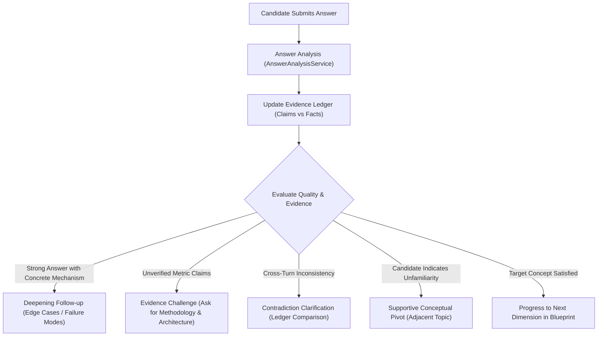

# PrepMate Feature — Adaptive AI Interview Engine

## 1. Overview
The Adaptive Interview Engine (`backend.Services.Analysis.AdaptiveInterviewEngine` and `InterviewFlowService`) replaces static linear question banks with dynamic, multi-turn conversational evaluation powered by the **Single AI Gateway (`https://api.vilao.ai/v1`)** using logical model alias **`PrepMate`**.

---

## 2. Adaptive Conversational Strategies

### 2.1 Deepening Follow-up
When a candidate provides a conceptually sound response, the AI does not immediately jump to an unrelated topic. It generates an architectural follow-up probing edge cases, scale constraints, failure modes, or concurrency tradeoffs.

### 2.2 Evidence Challenge
If a candidate makes quantitative performance claims (e.g., "Reduced latency by 80%") without describing the underlying mechanisms, the AI challenges the claim politely, requesting specific methodologies, metrics, or tooling. The claim is recorded in `EvidenceLedger.CandidateClaims` and is only promoted to `ObservedFacts` upon verification.

### 2.3 Contradiction Detection
The engine maintains the full session history via `EvidenceLedger`. If a candidate contradicts a statement made in an earlier turn, the interviewer flags the discrepancy and prompts the candidate to clarify.

### 2.4 Graceful Pivot on Unfamiliarity
When a candidate indicates that they are unfamiliar with a concept ("Tôi chưa có kinh nghiệm về vấn đề này"), the interviewer acknowledges this gracefully and pivots to a related fundamental concept rather than penalizing repeatedly on the same unknown topic.

---

## 3. Evidence Ledger & Data Governance

Each interview session maintains an isolated `EvidenceLedger` snapshot:
- **`SessionId` Isolation:** Ledger entries are strictly bounded to their originating session. Cross-session metrics are never mixed.
- **`ObservedFacts`:** Confirmed candidate statements showing practical engineering depth.
- **`CandidateClaims`:** Unsubstantiated claims awaiting verification.
- **`InformationGaps`:** Unassessed skills required by the job family blueprint.
- **`Contradictions`:** Direct conflicts detected between interview turns.

---

## 4. Upstream Gateway Resilience & No-AI Mode

- **Single Gateway Routing:** Requests route through `IPrepMateAIClient` to `https://api.vilao.ai/v1/chat/completions` with model alias `PrepMate`.
- **Vilao Combo Root:** Model orchestration, failover, and rate-limit mitigation are managed upstream by Vilao's Combo Root.
- **No-AI Mode:** If upstream credentials are not configured or if an outage occurs, `NoAiModeService` activates deterministic domain questions and fallback evaluations, preventing user-facing 500 errors.
- **Scoring Normalization:** All interview evaluations are projected into the standardized **0–100 point scale** for consistent presentation.
