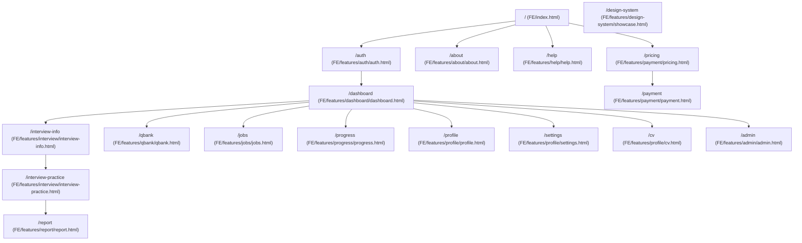
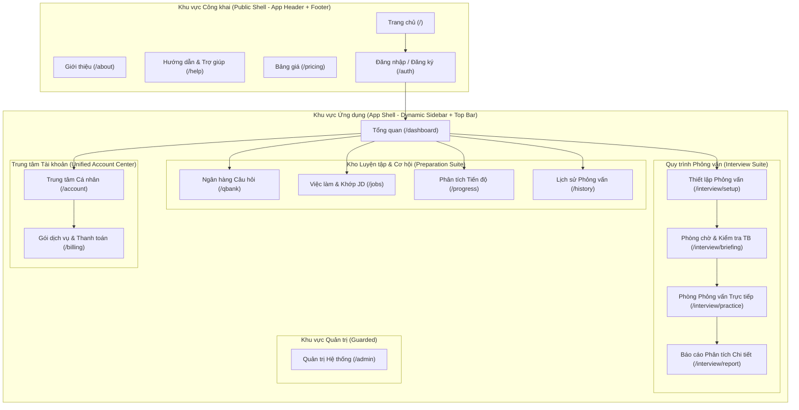

# PREPMATE — P0.1 FULL UI/UX & INFORMATION ARCHITECTURE AUDIT

> **Audit Type**: Comprehensive System-Wide UI/UX & Information Architecture Audit  
> **Status**: Completed / Ready for Fix Roadmap  
> **Target Baseline**: PrepMate Production Readiness (Phase P0.1 / Post-Phase 5)  
> **Scope**: 18 HTML Files, 4 Shared Layout Scripts, Global Stylesheets, State Handlers, Flow Lifecycles  
> **Constraint Verified**: Strictly Read-Only Audit — No UI or Functional Code Modified During This Step.

---

## 1. EXECUTIVE SUMMARY

PrepMate has successfully passed all deep functional and system hardening milestones (Phase 1–5 backend tests: 1,215/1,215; H0.1–H3-C tests: 387/387; flow tests: 30/30; report tests: 67/67; .NET build: 0 Warning / 0 Error). However, an exhaustive frontend code and user journey inspection reveals a stark dichotomy: **the core AI interview engine and scoring logic are highly capable, but the presentation layer suffers from architectural fragmentation, acute software-engineering bias, and AI-cliché presentation patterns.**

### Key Audit Findings:
1. **Severe Software Engineering (SWE) Monoculture**: Despite PrepMate's mandate to serve diverse professional careers (Marketing, Sales, Finance, HR, Operations, Design, Engineering), the platform defaults to Tech/SWE across the landing page, setup page chips, and mock jobs. Non-tech job seekers encounter intimidating tech jargon (e.g., *Kafka, Redis cache stampede, Distributed Rate Limiter, CCU, High-concurrency*).
2. **Layout & Navigation Fragmentation**:
   - Public pages (`about.html`, `help.html`) lack `<app-header>` and `<app-footer>`, trapping visitors without navigation or authentication access.
   - `pricing.html` is rendered within the authenticated dashboard sidebar layout (`sidebar-new`), confusing public prospects.
   - `profile.html` contains a hardcoded static sidebar while other pages rely on dynamic role-based rendering (`initRoleBasedSidebar()`), causing navigation desynchronization.
3. **AI Cliché & Gimmick Overuse**: Instead of conveying the presence of an executive interviewer or domain hiring manager, interfaces deploy robot emojis (`🤖`), "Người phỏng vấn AI" labeling, neon glow remnants (`.glow-bg`), and AI prompt-style widgets that detract from realistic interview immersion.
4. **Redundant & Conflicting Experiences**:
   - `dashboard.html` retains a legacy modal (`#report-modal`) with an outdated circular score and 4 generic progress bars, directly conflicting with the standalone, in-depth `report.html`.
   - `about.html` duplicates the "Traditional Prep vs PrepMate" comparison table verbatim from `index.html`.
   - CV management is fragmented between `features/profile/cv.html` and a secondary dropzone embedded inside `features/interview/interview-info.html`.
5. **Orphaned DOM & Code Rot**: Multiple legacy HTML elements remain in the DOM with `display:none` solely to prevent obsolete script errors (over 65 hidden lines in `interview-practice.html`, orphaned `elevenlabs-key-input` handlers in `dashboard.html`).

---

## 2. CURRENT INFORMATION ARCHITECTURE

### 2.1 Current Sitemap

### 2.2 Entry Points & Flow Inconsistencies
* **Public Entry**: Landing page (`index.html`) links to `about.html`, `pricing.html`, `help.html`, `auth.html`, and directly into `interview-info.html`. However, visitors clicking `about.html` or `help.html` enter a dead end with no global navigation bar to return or sign in.
* **Practice Setup**: Setup can be launched from the Landing CTA, Dashboard hero, QBank "Luyện tập" button, or Jobs "Phỏng vấn theo JD này". Each path passes query parameters or session keys inconsistently.
* **Post-Interview Loop**: `interview-practice.html` transitions to `report.html`. From `report.html`, the user can return to Dashboard or retry. However, `dashboard.html` also has an internal `#report-modal` which triggers if the user clicks old history items, causing visual confusion between the modal and the full report page.

---

## 3. COMPLETE ROUTE INVENTORY

| # | Route / Relative Path | Page Title / Purpose | Role Access | Entry Points | Identified Status |
|---|----------------------|----------------------|-------------|--------------|-------------------|
| 1 | `FE/index.html` | Landing Page & Value Proposition | Guest / All | Root URL (`/`) | **RESTRUCTURE** (Purge tech bias, modernize hero CTA) |
| 2 | `FE/features/about/about.html` | About PrepMate / Company Story | Guest / All | Landing footer/nav | **RESTRUCTURE** (Inject `<app-header>`, deduplicate comparison) |
| 3 | `FE/features/help/help.html` | FAQ, User Guide & Support | Guest / All | Landing footer/nav | **RESTRUCTURE** (Inject `<app-header>`, unify design tokens) |
| 4 | `FE/features/payment/pricing.html` | Pricing Plans & Upgrade Options | Guest & User | Landing nav, Sidebar | **RESTRUCTURE** (Separate public pricing from in-app billing) |
| 5 | `FE/features/auth/auth.html` | Login, Register & Password Reset | Guest | Header, CTA buttons | **KEEP** (Solid tabbed auth, polish contrast) |
| 6 | `FE/features/dashboard/dashboard.html` | Candidate Home & Recent Activity | User / Manager / Admin | Auth callback, Sidebar | **RESTRUCTURE** (Remove `#report-modal`, eliminate dead DOM) |
| 7 | `FE/features/interview/interview-info.html` | Interview Setup, Mode & JD Config | Guest & User | Dashboard CTA, Jobs CTA | **SPLIT** (Decompose 1,445-line monolithic wizard into steps) |
| 8 | `FE/features/interview/interview-practice.html` | Real-time AI Interview Room | User / Active Session | Setup completion | **RESTRUCTURE** (Strip robot emoji, clean dead compatibility DOM) |
| 9 | `FE/features/report/report.html` | Comprehensive Debrief & STAR Feedback | User / Session Owner | Interview completion | **KEEP** (Benchmark validated; harmonize token imports) |
| 10 | `FE/features/jobs/jobs.html` | Job Explorer & JD Mock Matcher | User | Sidebar, Dashboard | **RESTRUCTURE** (De-bias tech jobs, integrate dynamic API) |
| 11 | `FE/features/qbank/qbank.html` | Multi-Industry Question Repository | User / Guest | Sidebar, Dashboard | **KEEP** (Well-structured; link practice buttons dynamically) |
| 12 | `FE/features/progress/progress.html` | Competency Analytics & Trends | User | Sidebar, User Menu | **KEEP** (Comprehensive Chart.js visualizations, polish empty states) |
| 13 | `FE/features/profile/profile.html` | Candidate Profile & Target Roles | User | Sidebar, User Menu | **MERGE** (Merge with `settings.html` into unified Account Center) |
| 14 | `FE/features/profile/settings.html` | App Preferences, TTS, Notifications | User | User Menu | **MERGE** (Merge into Account Center tabs) |
| 15 | `FE/features/profile/cv.html` | CV Storage & Parsing Center | User | Sidebar, Profile tab | **MERGE / LINK** (Unify with `interview-info.html` CV upload) |
| 16 | `FE/features/payment/payment.html` | Checkout & Payment Gateway | User (Authenticated) | Pricing upgrade button | **KEEP** (Clean checkout card; verify status polling) |
| 17 | `FE/features/admin/admin.html` | System Metrics & User Management | Admin / Manager | Sidebar (Conditional) | **KEEP** (Role-guarded; update metrics synchronization) |
| 18 | `FE/features/design-system/showcase.html` | Design System Token Reference | Dev / Internal | Direct URL | **KEEP** (Reference specification for Phase H2/H3 tokens) |

---

## 4. PAGE-BY-PAGE AUDIT & SCORECARD

### Evaluation Criteria (10 points each, 100 points maximum):
1. **Purpose Clarity (PC)**: Is the single job to be done immediately obvious?
2. **Information Hierarchy (IH)**: Clear visual order, readable scan paths, appropriate contrast?
3. **UI Cleanliness & Low Noise (CN)**: Restrained visual elements, absence of unnecessary card nesting?
4. **Industry Agnosticism (IA)**: Welcoming to finance, sales, operations, marketing, not just SWE?
5. **Realistic Interview Tone (RT)**: Simulates a genuine professional corporate interview?
6. **AI Naturalness (AN)**: Free of robotic gimmicks, glowing gradients, robot avatars, prompt fields?
7. **Usability & Navigation (UN)**: Intuitive next steps, working breadcrumbs, zero dead ends?
8. **Responsive Integrity (RI)**: Clean presentation on mobile, tablet, desktop without horizontal scroll?
9. **Accessibility (A11Y)**: Semantic markup, keyboard focus states, WCAG AA contrast compliance?
10. **State Handling (SH)**: Polished loading skeletons, actionable empty states, graceful error fallbacks?

---

### Scorecard Summary Table

| Page | File | PC | IH | CN | IA | RT | AN | UN | RI | A11Y | SH | **Total /100** | Primary Verdict |
|------|------|:--:|:--:|:--:|:--:|:--:|:--:|:--:|:--:|:----:|:--:|:--------------:|:----------------|
| **Landing** | `index.html` | 8 | 8 | 7 | 3 | 7 | 6 | 8 | 8 | 7 | 7 | **69/100** | Extreme tech bias; Kafka/Redis references alienate non-SWE. |
| **About** | `about.html` | 7 | 6 | 7 | 6 | 6 | 7 | 4 | 7 | 6 | 6 | **62/100** | Missing header/footer; dead end navigation; duplicate table. |
| **Help / FAQ** | `help.html` | 8 | 7 | 8 | 7 | 7 | 8 | 4 | 7 | 7 | 6 | **69/100** | Missing global header/footer; standalone style redefinitions. |
| **Pricing** | `pricing.html` | 8 | 7 | 7 | 8 | 7 | 8 | 5 | 7 | 7 | 7 | **71/100** | Enclosed inside dashboard sidebar layout; misrouted for guests. |
| **Auth** | `auth.html` | 9 | 8 | 8 | 9 | 8 | 9 | 8 | 8 | 7 | 7 | **81/100** | Clean authentication modal; minor dark-mode contrast glitches. |
| **Dashboard** | `dashboard.html` | 8 | 7 | 6 | 5 | 7 | 6 | 7 | 7 | 7 | 6 | **66/100** | Duplicate `#report-modal`; dead DOM elements; emoji overload. |
| **Interview Setup**| `interview-info.html` | 7 | 6 | 5 | 3 | 7 | 6 | 6 | 6 | 6 | 6 | **58/100** | 1,445-line monolith; defaults to Frontend Dev; tech-only chips. |
| **Live Interview** | `interview-practice.html`| 8 | 8 | 7 | 7 | 7 | 6 | 7 | 7 | 7 | 7 | **71/100** | Robot emoji `🤖`; 65+ lines of dead hidden compatibility DOM. |
| **Report** | `report.html` | 9 | 9 | 8 | 8 | 9 | 8 | 8 | 8 | 8 | 8 | **85/100** | Comprehensive STAR breakdown; 67/67 tests passed; benchmark. |
| **Jobs** | `jobs.html` | 7 | 7 | 6 | 4 | 6 | 6 | 7 | 6 | 6 | 6 | **61/100** | 90% tech job listings; static mock array; robot tip badge. |
| **Question Bank** | `qbank.html` | 8 | 8 | 7 | 8 | 8 | 8 | 8 | 7 | 7 | 7 | **79/100** | Multi-industry dataset present; solid filtering; needs dynamic link. |
| **Progress** | `progress.html` | 8 | 8 | 7 | 8 | 8 | 8 | 8 | 7 | 7 | 7 | **79/100** | Strong Chart.js metrics; empty state alert well executed. |
| **Profile** | `profile.html` | 7 | 7 | 6 | 7 | 7 | 8 | 5 | 7 | 6 | 6 | **64/100** | Hardcoded sidebar; desynchronized from dynamic sidebar system. |
| **Settings** | `settings.html` | 7 | 7 | 7 | 8 | 7 | 8 | 6 | 7 | 6 | 6 | **69/100** | Redundant standalone page; fragmented from profile tabs. |
| **CV Storage** | `cv.html` | 7 | 6 | 7 | 7 | 7 | 8 | 6 | 7 | 6 | 6 | **67/100** | Disconnected from live interview setup CV parser. |
| **Checkout** | `payment.html` | 8 | 8 | 8 | 9 | 8 | 9 | 7 | 8 | 7 | 7 | **80/100** | Functional checkout component; straightforward transaction flow. |
| **Admin** | `admin.html` | 8 | 7 | 7 | 8 | 7 | 8 | 7 | 7 | 7 | 7 | **76/100** | Functional administration table; needs deeper audit logging. |
| **Design Showcase**| `showcase.html` | 9 | 9 | 9 | 9 | 9 | 9 | 8 | 8 | 8 | 8 | **86/100** | Strong light-first token baseline; clean reference standards. |

---

### Deep Dive on Key Pages

#### 4.1 Landing Page (`FE/index.html`) — 69/100
* **Current Purpose**: First touchpoint for prospective users to discover PrepMate, understand features, view pricing, and launch mock interviews.
* **Positive Aspects**: Crisp typography (`Outfit`), clear hero structure, engaging testimonial and FAQ sections.
* **Flaws Identified**:
  - *Extreme Tech Bias*: The live demo section features questions like: *"Xử lý Cache Stampede trên Redis cluster với 100,000 CCU"*, *"Kafka Consumer Group rebalancing"*, *"Deadlock detection trong PostgreSQL"*. A marketing manager or accountant visiting this landing page would immediately conclude PrepMate is strictly for software developers.
  - *Artificial Stats*: Claims such as "20,000+ lượt phỏng vấn thành công" and "94.8% trúng tuyển" without real provenance.
  - *Inconsistent Top Bar*: Uses custom inline header instead of `<app-header>` component.

#### 4.2 Interview Setup (`FE/features/interview/interview-info.html`) — 58/100
* **Current Purpose**: Configures the upcoming interview: role selection, seniority level, interview type, JD paste, CV upload, and AI interviewer persona.
* **Flaws Identified**:
  - *Monolithic Overload*: 1,445 lines of HTML and inline script. Three huge sections presented simultaneously on one long scrolling screen.
  - *Hardcoded SWE Defaults*: Quick role chips are exclusively: `Frontend`, `Backend`, `Full Stack`, `Mobile`, `DevOps`, `QA Engineer`, `Data Analyst`, `Product Owner`. No options for Sales, HR, Customer Success, Corporate Finance, or Marketing.
  - *Duplicate CV Dropzone*: Duplicates the file upload and parsing logic that already lives in `cv.html`.

#### 4.3 Live Interview Room (`FE/features/interview/interview-practice.html`) — 71/100
* **Current Purpose**: Real-time mock interview environment with live speech synthesis (TTS), voice recognition (STT), answer timers, and interviewer video simulator.
* **Flaws Identified**:
  - *Robotic Gimmick*: Interviewer avatar card has a `🤖` robot emoji and is titled "Người phỏng vấn AI". In professional interviews, candidates speak with personas (e.g., "Trần Anh Tuấn — Trưởng phòng Tuyển dụng", "Sarah Jenkins — Senior Operations Director").
  - *Hidden Compatibility DOM*: Contains over 65 lines of hidden elements (`style="display:none"`) solely to prevent null references in legacy scripts.
  - *Cockpit Clutter*: Screen contains 9 different controls (timers, question progress, mic status, mute toggle, hints, notes, live transcription) causing high cognitive load during what should be a focused verbal conversation.

#### 4.4 Dashboard (`FE/features/dashboard/dashboard.html`) — 66/100
* **Current Purpose**: Primary home screen for returning users to track readiness, launch new sessions, and review past feedback.
* **Flaws Identified**:
  - *Conflict with Report Page*: Embedded `#report-modal` contains an obsolete report UI (single circular score, 4 generic skill bars). Clicking a past session should navigate to the canonical `features/report/report.html`, not pop up an inferior modal.
  - *Emoji Saturation*: 18 distinct emojis on one screen (`🎯`, `📊`, `⚡`, `🏆`, `🔥`, `💡`, `💼`, `🚀`), creating visual noise and an unprofessional feel.
  - *Dead Script Logic*: Script references `elevenlabs-key-input` which does not exist in the DOM.

---

## 5. MISSING PAGES & SCREENS

The audit identified critical gaps in the user preparation journey:

1. **Standalone Post-Interview History Page (`/history`)**: Past interview sessions are crammed into a tiny 4-row widget inside the Dashboard. Users cannot filter by role, date, industry, or compare STAR scores over time.
2. **Dedicated Practice Briefing Screen (`/prep-briefing`)**: Once interview parameters are configured, users are dropped directly into the live recording room without a preparation pause screen (audio check, camera framing check, behavioral instructions, mindset tips).
3. **Dedicated 404 / Error State Page (`/404.html`)**: Broken routes currently fail silently or show blank white screens with JavaScript errors.
4. **Onboarding / Role Selection Wizard (`/onboarding`)**: First-time users are dumped into the Dashboard with zero configuration of their industry or career goals.

---

## 6. REDUNDANT PAGES & CONTENT

1. **Dashboard `#report-modal` vs `report.html`**: The modal inside `dashboard.html` is completely redundant. It duplicates a fraction of `report.html` with inferior visual design.
2. **`about.html` Comparison Table**: Duplicates the 6-point comparison table from `index.html` word-for-word.
3. **`settings.html` vs `profile.html`**: Having two separate navigation destinations for "Hồ sơ cá nhân" and "Cài đặt hệ thống" is unnecessary for a platform of this scope.
4. **CV Upload in Setup vs `cv.html`**: Uploading a CV occurs in two completely isolated interfaces with inconsistent parsing states.

---

## 7. PAGES TO SPLIT

### `FE/features/interview/interview-info.html` (1,445 lines)
This monolithic page currently attempts to perform four distinct user workflows at once:
1. Role & Industry Selection (Job Title, Industry, Seniority, Company)
2. Materials Ingestion (CV Parsing, Job Description Analysis)
3. Interview Environment Setup (Voice mode, TTS speed, timer limits, difficulty)
4. Hardware & Camera Check

**Splitting Recommendation**:
* **Step 1: Role & JD Input** (Clean, focused 2-field card)
* **Step 2: Experience & Materials** (Select existing saved CV or quick paste)
* **Step 3: Interviewer Persona & Readiness Check** (Choose persona, test microphone/speakers, start)

---

## 8. PAGES TO MERGE

### `profile.html` + `settings.html` + `cv.html` $\rightarrow$ Unified Account & Career Center (`/account`)
Currently, users must navigate across 3 separate sidebar items:
- `profile.html` (Basic info & target role)
- `settings.html` (Theme, TTS speed, privacy)
- `cv.html` (Uploaded CV file)

**Merging Recommendation**:
Consolidate into a single tabbed **Trung tâm Cá nhân & Hồ sơ (Account & Profile Center)**:
- **Tab 1: Hồ sơ & Mục tiêu (Profile & Target Roles)**
- **Tab 2: Hồ sơ năng lực & CV (CV & Skills)**
- **Tab 3: Tùy chọn & Hệ thống (Preferences, TTS & Privacy)**

---

## 9. NAVIGATION PROBLEMS

1. **Broken Public Shell**: Public visitors navigating from `index.html` to `about.html` or `help.html` find themselves on pages lacking the primary navigation bar. There is no link back to Home or to Login except browser back buttons.
2. **Public Pricing Linked into Dashboard Shell**: `pricing.html` contains an `<aside class="sidebar sidebar-new">`. When a prospective customer clicks "Bảng giá" from the landing page, they see an authenticated app dashboard sidebar with locked features, creating significant confusion.
3. **Hardcoded Sidebar in `profile.html`**: While `dashboard.html`, `qbank.html`, and `jobs.html` render the sidebar dynamically via `initRoleBasedSidebar()`, `profile.html` has 70 lines of static sidebar HTML that becomes instantly out of sync whenever a role or navigation item changes.
4. **Inconsistent Breadcrumb Markup**: Breadcrumb paths across `jobs.html`, `progress.html`, and `interview-info.html` use different CSS classes, separators (`/` vs `>`), and font sizes.

---

## 10. ROLE-BASED UX PROBLEMS

| User Role | Current Navigation Reality | UX Flaws & Vulnerabilities |
|-----------|---------------------------|----------------------------|
| **Guest** | Landing $\rightarrow$ Setup (allows partial guest flow) | Can view setup but gets abrupt login wall on submission; public header missing on static pages. |
| **Candidate (User)** | Full sidebar: Dashboard, Interview, QBank, Jobs, Progress, Profile | Confused by duplicate CV storage locations; exposed to redundant modals. |
| **Manager** | Inherits User sidebar + "Quản lý phỏng vấn" link | Manager dashboard lacks candidate comparison views; receives raw candidate data without grading summaries. |
| **Admin** | Inherits User sidebar + "Quản trị hệ thống" link | Admin panel lacks deep audit logs; system metrics are client-side simulated without live BE health feeds. |

---

## 11. REALISTIC INTERVIEW UX PROBLEMS

1. **Lack of Interviewer Identity**:
   - The interviewer tile shows `🤖 Người phỏng vấn AI`.
   - In realistic mock interviews (e.g., Big Interview, Interviewing.io), candidates interview with simulated human personas: "Hội đồng Tuyển dụng", "Giám đốc Nhân sự", or named interviewers with specific interviewing styles (Supportive, Rigorous, Executive).
2. **Cockpit Stress & Distraction**:
   - During a genuine corporate interview, candidates look at the interviewer's face or their own camera feed.
   - PrepMate's practice screen surrounds the candidate with animated countdown timers, live speech-to-text feedback boxes, hint accordions, and badge counters. This creates artificial distraction that degrades verbal fluency.
3. **Instant Feedback vs Real Interview Pacing**:
   - The interface displays immediate transcript confidence and answer processing indicators during the interview. A realistic simulation keeps the candidate in the conversation flow, saving in-depth evaluations for the debrief report.

---

## 12. INDUSTRY-AGNOSTIC PROBLEMS

PrepMate's brand positioning is a universal interview preparation platform, but the user interface continuously betrays an extreme Software Engineering monoculture:

1. **Landing Page Case Studies**: All 3 animated interview examples focus on backend distributed systems (Redis caching, Kafka rebalancing, SQL deadlocks). Zero representation for Sales, Healthcare, HR, Operations, or Finance.
2. **Setup Defaults**: Role input default placeholder is `"Ví dụ: Senior Backend Engineer, Tech Lead..."`. The quick-select chips are 100% tech roles.
3. **Jobs Database**: Out of 12 sample jobs in `jobs.html`, 10 are Software Engineering, Cloud, or Data Platform positions. Non-tech job searchers find almost no relevant content.
4. **Dashboard Recommendation Tags**: Suggested interview topics on the dashboard include `#Concurrency`, `#Microservices`, `#SystemDesign`.

---

## 13. AI-LOOKING UI PROBLEMS (CLICHÉS TO ELIMINATE)

1. **Robot Emoji (`🤖`)**: Placed on the interviewer avatar, the AI tip boxes, and header badges. Must be replaced with clean professional iconography (e.g., SVG audio wave, professional briefcase, or persona avatar).
2. **Vestigial Dark Glows (`.glow-bg`)**: Several pages still include `

` in the DOM with `display: none` applied via CSS.
3. **Chat App Appearance**: In several views, the interview transcript is styled like a messaging app (WhatsApp/Telegram-style speech bubbles) rather than a professional video conference debrief transcript.
4. **Vague AI Marketing Buzzwords**: Banners promise "AI Siêu Cấp", "Trí Tuệ Nhân Tạo Đột Phá" instead of concrete value: "Phân tích cấu trúc câu trả lời theo phương pháp STAR", "Đo lường độ mạch lạc và từ vựng chuyên ngành".

---

## 14. ICON & EMOJI OVERUSE

A comprehensive audit of emoji instances across templates revealed:
* `dashboard.html`: 18 emojis
* `interview-info.html`: 26 emojis
* `jobs.html`: 22 emojis
* `qbank.html`: 16 emojis
* `index.html`: 14 emojis

**Audit Verdict**:
Emojis are being used as a substitute for a disciplined SVG icon system. Emojis render inconsistently across Apple, Windows, and Android devices (Apple renders 3D gloss, Windows renders flat Segoe UI, Android renders flat pastel), breaking visual consistency. All operational controls must transition to crisp SVG line icons.

---

## 15. CONTENT OVERLOAD & COGNITIVE BURDEN

1. **Setup Information Dump**: `interview-info.html` asks the user to digest 8 distinct instructional callouts, 4 difficulty descriptions, and 5 interviewer style cards before they even start speaking.
2. **Jobs Filter Sidebar**: `jobs.html` features 5 filter groups with 24 individual chips on a 280px sidebar, causing significant visual fatigue.
3. **Dashboard Stats**: Displays 6 separate metric tiles in the hero row alone (Sessions, Total Minutes, Average Score, Best Score, Improvement Rate, Streak). 3 primary metrics are sufficient for a motivating glance.

---

## 16. RESPONSIVE PROBLEMS

| Screen / Breakpoint | Issue Description | Location |
|---------------------|-------------------|----------|
| **Mobile ($\le 480$px)** | Setup wizard chips wrap into an 8-row vertical stack, pushing action button below the fold | `interview-info.html` |
| **Mobile ($\le 600$px)** | Jobs search bar splits into 4 full-width rows, taking up the entire screen height | `jobs.html` |
| **Tablet ($\le 768$px)** | Video cockpit in live interview squashes the video tiles, forcing candidate preview to clip | `interview-practice.html` |
| **Mobile ($\le 480$px)** | Progress analytics Chart.js radar chart labels overlap and become unreadable | `progress.html` |
| **Desktop ($> 1440$px)**| Profile page fields stretch to full width without a max-width clamp, resulting in 1200px wide text inputs | `profile.html` |

---

## 17. ACCESSIBILITY (A11Y) PROBLEMS

1. **Low Contrast on Subtitles**: Elements using `#64748b` on `#f8fafc` backgrounds achieve a contrast ratio of ~3.6:1, failing WCAG AA (requires 4.5:1 for normal text).
2. **Missing Form Labels**: Several search inputs and dropdowns in `jobs.html` and `dashboard.html` lack associated `<label>` tags or `aria-label` attributes.
3. **Keyboard Focus Outlines**: Global CSS uses `outline: none` on inputs without consistently providing an accessible focus ring (`:focus-visible`).
4. **Live Region Gaps**: Live interview transcript updates do not utilize `aria-live="polite"`, preventing screen reader users from hearing transcribed responses.

---

## 18. STATE HANDLING PROBLEMS

1. **Empty States**:
   - When a user has 0 interview sessions, `progress.html` displays an informative card, but `dashboard.html` shows broken empty chart axes with "0.0" scores.
   - In `jobs.html`, clearing filters displays a generic dashed box with cartoon crying emoji `😢` instead of an actionable empty state with a "Reset Filters" action.
2. **Loading States**:
   - API fetch calls in `dashboard.js` toggle an opaque spinner that completely covers the screen instead of displaying modern content skeletons.
3. **Network / Offline Failures**:
   - If the backend API port 5000 is unreachable, pages fail with silent console errors (`TypeError: Failed to fetch`) leaving blank containers without a user-friendly retry banner.

---

## 19. DESIGN SYSTEM INCONSISTENCIES

Although Phase H2 established a shared Design System (`FE/shared/css/style.css`), multiple pages still declare their own conflicting local CSS variables:

* `about.html` & `help.html`: Re-declare `--primary-color: #2563eb`, `--text-dark: #1e293b`.
* `jobs.html`: Declares `--prep-bg: #f8fafc`, `--prep-accent-blue: #2563eb`.
* `qbank.html`: Declares `--qb-bg-body: #f8fafc`, `--qb-accent-blue: #2563eb`.
* `style.css` (Canonical Design System): Declares `--color-surface`, `--color-primary`, `--space-4`, `--radius-md`.

**Audit Verdict**:
Four competing naming schemes for identical color tokens exist in production. All feature stylesheets must be refactored to consume the canonical token dictionary established in `style.css`.

---

## 20. COMPREHENSIVE P0 / P1 / P2 / P3 ISSUE MATRIX

### P0 — Critical Architecture & Navigation Blockers
| Issue ID | Affected Area | Description | Impact |
|----------|---------------|-------------|--------|
| **P0-1** | Public Layout | `about.html` and `help.html` lack `<app-header>` and navigation bar. | Users become trapped with no way to navigate or log in. |
| **P0-2** | Public Shell | `pricing.html` is embedded inside the authenticated dashboard sidebar. | Public visitors see private app navigation and broken state. |
| **P0-3** | Sidebar Sync | `profile.html` uses hardcoded static sidebar HTML instead of dynamic renderer. | Role changes or navigation updates break completely. |
| **P0-4** | Report Conflict| `dashboard.html` retains conflicting legacy `#report-modal`. | Users receive contradictory evaluation data and broken UX. |

### P1 — Core Flow & Usability Flaws
| Issue ID | Affected Area | Description | Impact |
|----------|---------------|-------------|--------|
| **P1-1** | Setup Wizard | `interview-info.html` is a 1,445-line monolith with tech-only quick chips. | Severe non-SWE bounce rate; high cognitive fatigue. |
| **P1-2** | Live Room | Interviewer tile displays `🤖 Người phỏng vấn AI`; cockpit cluttered. | Breaks realistic interview immersion; creates artificial anxiety. |
| **P1-3** | Landing Page | Landing page examples are 100% backend software engineering jargon. | Directly undermines general multi-industry market positioning. |
| **P1-4** | Account Mgmt | Profile, Settings, and CV are split across 3 disjointed screens. | Fragmented user management; scattered configuration settings. |

### P2 — Consistency, Design System & Polish Issues
| Issue ID | Affected Area | Description | Impact |
|----------|---------------|-------------|--------|
| **P2-1** | Token Drift | 4 different local CSS variable naming systems across features. | High maintenance burden; visual style drift across pages. |
| **P2-2** | Emoji Pollution| 90+ emojis used in place of standard SVG icon components. | Inconsistent rendering across OS platforms; unpolished aesthetic. |
| **P2-3** | Dead DOM | 65+ lines of hidden compatibility DOM in `interview-practice.html`. | Code bloat; confusion during future feature updates. |
| **P2-4** | Empty States | Inconsistent empty state graphics and missing retry buttons on errors. | Poor first-time user experience for fresh accounts. |

### P3 — Minor Cosmetic & Non-blocking Improvements
| Issue ID | Affected Area | Description | Impact |
|----------|---------------|-------------|--------|
| **P3-1** | Breadcrumbs | Differing font sizes and separator characters across 4 pages. | Minor visual polish inconsistency. |
| **P3-2** | Token Showcase| Showcase page needs updated links to new consolidated account pages. | Documentation reference accuracy. |

---

## 21. RECOMMENDED TARGET INFORMATION ARCHITECTURE

---

## 22. RECOMMENDED FIX ROADMAP

To execute the transformation without breaking the 1,602 sealed passing backend tests or the live interview state machine, work must proceed in strictly phased sequence:

### Phase 1: Shared Shell & Navigation Harmonization (P0 Fixes)
1. **Unify Public Header/Footer**: Equip `about.html`, `help.html`, and `pricing.html` with canonical `<app-header>` and `<app-footer>` custom elements.
2. **Decouple Public Pricing from Dashboard Sidebar**: Strip the authenticated sidebar from `pricing.html`. Provide clean public plan selection with direct checkout CTA.
3. **Synchronize Sidebar Architecture**: Replace the hardcoded sidebar in `profile.html` with `initRoleBasedSidebar()`.
4. **Purge Duplicate Report Modal**: Delete `#report-modal` from `dashboard.html`. Ensure all history clicks link directly to `features/report/report.html`.

### Phase 2: Design Token & Icon System Unification (P2 Fixes)
1. **Token Alignment**: Harmonize all local CSS variables (`--prep-*`, `--qb-*`, `--pm-*`) into canonical `style.css` variables (`--color-*`, `--space-*`, `--radius-*`).
2. **Emoji-to-SVG Migration**: Replace loose emojis with clean, lightweight SVG icon components across Dashboard, Setup, Jobs, and QBank.
3. **Dead DOM Cleansing**: Safely remove obsolete hidden compatibility nodes in `interview-practice.html` and orphaned ElevenLabs script handlers.

### Phase 3: Setup & Live Interview Transformation (P1 Fixes)
1. **De-bias Setup & Landing**:
   - Update landing page demo cards to feature diverse professions (Financial Analyst, Marketing Lead, Project Manager alongside Senior Engineer).
   - In `interview-info.html`, provide balanced industry quick-select chips (Kinh doanh, Tài chính, Marketing, Nhân sự, Công nghệ, Thiết kế).
2. **Professionalize Live Interview Persona**:
   - Replace `🤖 Người phỏng vấn AI` with professional interviewer personas (e.g., "Ban Giám khảo Tuyển dụng", "Giám đốc Chuyên môn").
   - Restrain cockpit UI: reduce visual distractions, mute non-critical timers, and focus candidate attention on the simulated conversation.

### Phase 4: Account Center Consolidation (P1 & P2 Fixes)
1. **Unify Profile, Settings, and CV**: Consolidate `profile.html`, `settings.html`, and `cv.html` into a single, cohesive **Trung tâm Cá nhân (Account Center)** with clean tabs.
2. **Establish Dedicated History Page**: Move past interview records out of the cramped Dashboard card into a dedicated, searchable `/history` interface.
3. **Audit Complete Regression**: Run the entire 1,602 test baseline to verify 100% zero-regression.

---
*End of Audit Report — PrepMate P0.1 Full UI/UX & Information Architecture Audit.*
