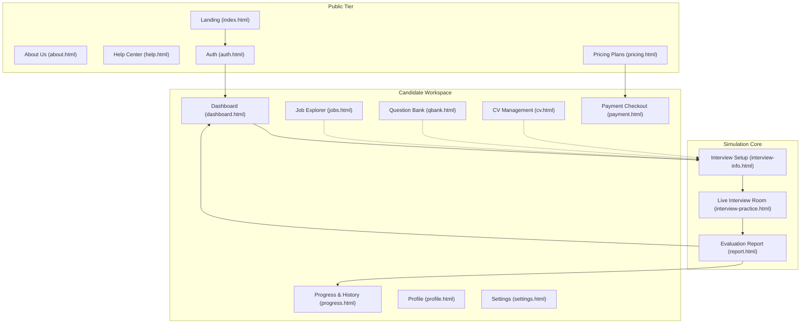
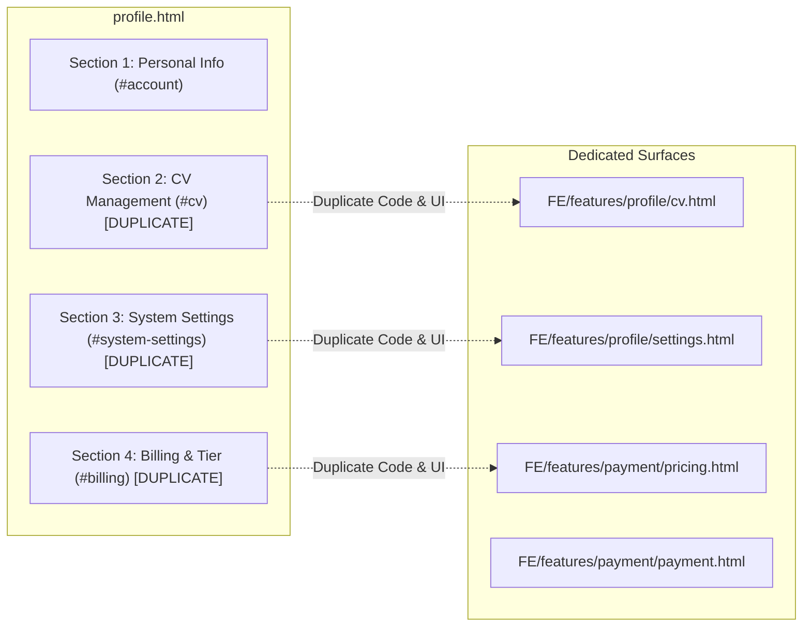
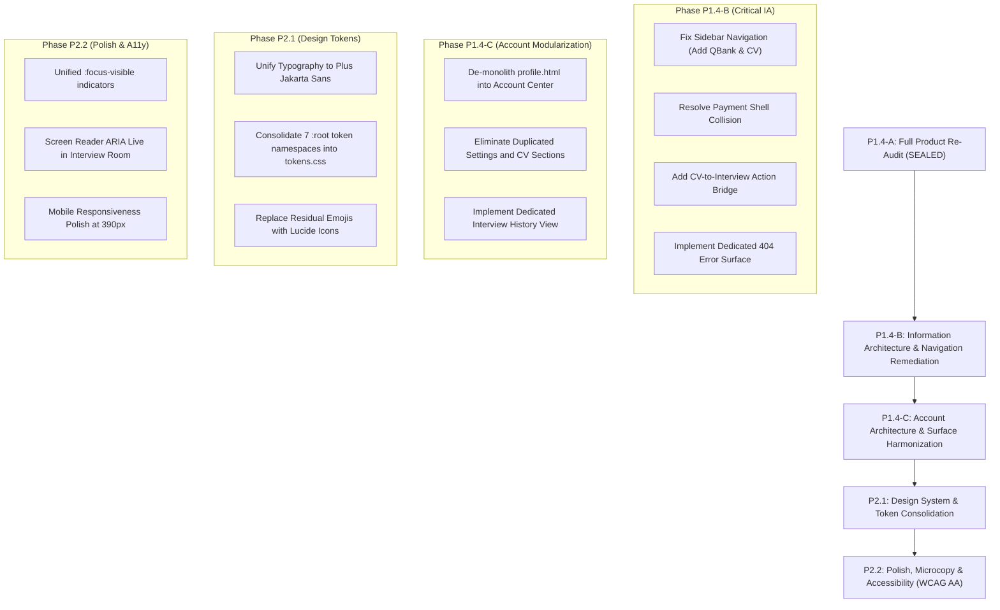

# PREPMATE — P1.4-A: FULL PRODUCT UX/UI RE-AUDIT
**Comprehensive Product-Wide Audit following Phases P0 → P1.3**
*Date: October 7, 2026 | Status: Sealed Baseline Verified | Verdict: CONDITIONAL — READY FOR REMEDIATION*

---

## 1. EXECUTIVE SUMMARY

The PrepMate web application has undergone extensive structural, simulation, and context remediation throughout Phases **P0.1, P0.2, P1.1, P1.2, P1.3 Wave A, and P1.3 Wave B**. The core interview pipeline—from the 4-step setup wizard to the live AI interview simulation room, context-adaptive evaluation engine, and multi-domain evaluation reports—is stable, resilient, and industry-neutral. 

However, a comprehensive re-audit of the entire product across its 18 HTML surfaces reveals significant **Information Architecture (IA) fragmentation, navigation divergence, account management overlap, design system token drift, and missing product surfaces**. While the core simulation experience operates at a high level of fidelity, peripheral workflows (e.g. CV management, Question Bank integration, checkout transition, and user account settings) exhibit disconnects that disrupt the end-to-end candidate journey.

### Key Audit Metrics
* **Total Front-end Surfaces Audited:** 18 HTML files across `FE/` and `FE/features/`
* **Automated Baseline Regression:** **249 / 249 PASS (100%)**
* **Backend Build:** **0 Warnings / 0 Errors**
* **Total Findings Discovered:** 24 distinct findings
  * **P0 (Critical Blockers):** 0 (All critical functional blockers resolved in P0–P1.3)
  * **P1 (High IA / Navigation / Surface Gaps):** 7
  * **P2 (Medium Consistency / Interaction / A11y):** 11
  * **P3 (Low Polish / Microcopy / Residual Tokens):** 6
* **Final Verdict:** **`CONDITIONAL — READY FOR REMEDIATION`**
  *(Core interview & report flows are sealed; peripheral navigation and account architecture require systematic remediation in P1.4-B and P1.4-C).*

---

## 2. BASELINE VERIFICATION

Prior to commencing the audit, all automated test suites and backend compilers were executed to guarantee an uncompromised, sealed baseline:

| Test Suite | Scope | Target | Result | Status |
| :--- | :--- | :---: | :---: | :---: |
| `test_industry_context.js` | Multi-industry context propagation, JobFamily inference, personas | 54 / 54 | **54 / 54** | **PASS** |
| `test_p13_presentation.js` | Presentation layer neutrality (report, progress, dashboard, cv, jobs) | 66 / 66 | **66 / 66** | **PASS** |
| `test_interview_setup_ux.js` | 4-step interview setup modal, validation, chip selectors, preflight | 20 / 20 | **20 / 20** | **PASS** |
| `test_live_interview_ux.js` | Live simulation stage, media controls, notes, pause/end modals | 12 / 12 | **12 / 12** | **PASS** |
| `test_interview_flow.js` | End-to-end interview pipeline, state transitions, audio synthesis | 30 / 30 | **30 / 30** | **PASS** |
| `test_report_ui.js` | Report sections, scoring dials, radar charts, question accordion | 67 / 67 | **67 / 67** | **PASS** |
| `dotnet build BE/backend.csproj` | Backend compilation, API contracts, entity schemas | 0W / 0E | **0W / 0E** | **PASS** |
| **TOTAL REGRESSION** | **All automated assertions across product** | **249 / 249** | **249 / 249** | **100% PASS** |

---

## 3. COMPLETE PAGE INVENTORY

PrepMate contains 18 distinct HTML surfaces organized across functional feature directories:

| # | Surface Path | Shell Type | Target Role | Primary Purpose | IA Tier | Mobile Ready | A11y Status |
| :--- | :--- | :--- | :--- | :--- | :---: | :---: | :---: |
| 1 | `FE/index.html` | Public Shell | Guest / All | Landing page, value proposition, features overview | Tier 1 | Partial (390px) | Needs focus rings |
| 2 | `FE/features/about/about.html` | Public Shell | Guest / All | Company vision, methodology, mission, team | Tier 2 | Good | Good |
| 3 | `FE/features/help/help.html` | Public Shell | Guest / All | Support center, knowledge base, FAQs, contact | Tier 2 | Good | Form needs labels |
| 4 | `FE/features/payment/pricing.html` | Public Shell | Guest / User | Plan tier comparisons (Free, Pro, Enterprise) | Tier 1 | Good | Contrast issues |
| 5 | `FE/features/auth/auth.html` | Auth Shell (Minimal) | Guest | Sign in, Sign up, SSO (Google/GitHub/LinkedIn) | Tier 1 | Good | ARIA invalid missing |
| 6 | `FE/features/dashboard/dashboard.html` | User Shell (Sidebar) | Candidate | Overview metrics, quick start, recent interviews | Tier 1 | Good | Good |
| 7 | `FE/features/interview/interview-info.html` | User Shell (Dedicated) | Candidate | 4-Step interview configuration & pre-flight setup | Tier 1 | Good | Good |
| 8 | `FE/features/interview/interview-practice.html` | Simulation Room (No Shell) | Candidate | Live interview room (video, avatar, transcript) | Tier 1 | Tablet/Desktop | Live region needed |
| 9 | `FE/features/report/report.html` | User Shell (Dedicated) | Candidate | Deep post-interview evaluation report & action plan | Tier 1 | Good | Good |
| 10 | `FE/features/progress/progress.html` | User Shell (Sidebar) | Candidate | Long-term skill progression, benchmarks & radar | Tier 2 | Good | Good |
| 11 | `FE/features/jobs/jobs.html` | User Shell (Sidebar) | Candidate | Job market explorer, JD analyzer & matching | Tier 2 | Good | Modal scroll lock |
| 12 | `FE/features/qbank/qbank.html` | User Shell (Sidebar) | Candidate | Question bank explorer, STAR answer guide | Tier 2 | Good | Quick chips focus |
| 13 | `FE/features/profile/cv.html` | User Shell (Sidebar) | Candidate | Dedicated CV management, parsing, skill extraction | Tier 2 | Good | Stranded CTA |
| 14 | `FE/features/profile/profile.html` | User Shell (Sidebar) | Candidate | Monolithic user profile, settings & billing anchor | Tier 2 | Fair | Redundant sections |
| 15 | `FE/features/profile/settings.html` | User Shell (Sidebar) | Candidate | System, audio/video, AI voice & privacy settings | Tier 2 | Good | Toggle switch labels |
| 16 | `FE/features/payment/payment.html` | Mixed Workspace Shell | Candidate | Checkout, order summary, payment method (VietQR) | Tier 2 | Fair | Shell mismatch |
| 17 | `FE/features/admin/admin.html` | Admin Shell (Sidebar) | Admin/Manager | User management, prompt config, system analytics | Admin | Tablet/Desktop | Table overflow |
| 18 | `FE/features/design-system/showcase.html` | Internal Shell | Developer | UI token showcase & component reference | Internal | Good | N/A |

---

## 4. INFORMATION ARCHITECTURE (IA) AUDIT

### 4.1 Sitemap & Mental Model
The current mental model exhibits a split between the **Public Marketing tier**, the **Interview Simulation core**, and the **Candidate Workspace**:



### 4.2 Information Architecture Flaws
1. **Redundant Profile Monolith:** `profile.html` contains 4 full sections (Personal Info `#account`, CV Upload `#cv`, System Settings `#system-settings`, and Billing `#billing`). Sections 2, 3, and 4 duplicate the dedicated pages `cv.html`, `settings.html`, and `pricing.html`/`payment.html`.
2. **Missing Dedicated History Surface:** Interview history currently exists only as an inline table inside `dashboard.html` (`#history-table-body`). Users looking for comprehensive session filtering, past transcripts, or cross-session comparisons are constrained to the dashboard overview.
3. **Missing Product Error Surface:** There is no `404.html` or client-side route fallback. Unmatched paths yield default server 404 error text.

---

## 5. NAVIGATION AUDIT

### 5.1 Dynamic Sidebar Construction (`FE/shared/js/main.js:1979-2239`)
PrepMate centralizes sidebar generation through `initRoleBasedSidebar()`. Analysis of navigation items reveals critical inconsistencies between user roles:

#### Role Navigation Discrepancy:
* **Guest Role:**
  * Tổng quan (`dashboard.html`)
  * Phỏng vấn (`interview-info.html`)
  * Tiến độ (`progress.html`)
  * Khám phá việc làm (`jobs.html`)
  * **Ngân hàng câu hỏi (`qbank.html`)** *(Present)*
* **Candidate User Role (`ROLE_USER` / `role === 'candidate'`):**
  * Tổng quan (`dashboard.html`)
  * Phỏng vấn (`interview-info.html`)
  * Khám phá việc làm (`jobs.html`)
  * Tiến độ (`progress.html`)
  * Lịch sử (`dashboard.html#history`)
  * **Ngân hàng câu hỏi (`qbank.html`)** ❌ **COMPLETELY MISSING!**
  * **Quản lý CV (`cv.html`)** ❌ **COMPLETELY MISSING!**

> **Critical Impact:** A logged-in candidate who relies on the primary sidebar navigation loses direct access to the Question Bank and CV Management surfaces. `cv.html` can only be reached via the user profile avatar dropdown, while `qbank.html` cannot be reached via standard sidebar navigation at all.

### 5.2 Header Navigation Synchronization
* **Public Header:** Synchronized across `index.html`, `about.html`, `help.html`, and `pricing.html` with unified brand styling and active link states.
* **Workspace Header:** Standardized across dashboard, jobs, progress, profile, and settings with notification bell and user dropdown.
* **Header Dropdown Links:** Avatar dropdown links to `profile.html`, `cv.html`, `settings.html`, and logout.

---

## 6. PUBLIC SHELL AUDIT

Pages Audited: `FE/index.html`, `FE/features/about/about.html`, `FE/features/help/help.html`, `FE/features/payment/pricing.html`

* **Harmonization Status:** Verified complete following P0.2. All public pages utilize the canonical `<app-header>` and `<app-footer>` components with uniform sticky headers, navigation links, and theme toggle.
* **Responsive Behavior:** Header collapses to a responsive drawer on viewports $< 768\text{px}$.
* **Identified Issues:**
  * `pricing.html`: Upgrade buttons link to `payment.html?plan=pro`, but the destination page switches shell contexts unexpectedly (see Section 7).
  * `index.html`: Hero section CTAs point to `interview-info.html` directly for unauthenticated users, triggering an auth redirect modal rather than explaining the prerequisite account setup.

---

## 7. USER SHELL AUDIT

Pages Audited: `dashboard.html`, `interview-info.html`, `report.html`, `progress.html`, `jobs.html`, `qbank.html`, `cv.html`, `profile.html`, `settings.html`, `payment.html`

### 7.1 Shell Anatomy Matrix
* **Standard Workspace Shell:** Top workspace header + collapsible left sidebar + content area (`dashboard.html`, `progress.html`, `jobs.html`, `qbank.html`, `cv.html`, `profile.html`, `settings.html`).
* **Focused Workspace Shell:** Top navigation bar only, no left sidebar, maximized viewport for high-focus tasks (`interview-info.html`, `report.html`).
* **Simulation Room (Distraction-Free):** Complete omission of standard shell; bespoke simulation control bar (`interview-practice.html`).

### 7.2 Shell Collision in Payment
* `payment.html` incorporates `<body class="dashboard-body">` and renders `<aside id="main-sidebar">`. However, it also renders an e-commerce-style top checkout bar (`.checkout-top-bar`). This creates a visual conflict between an administrative dashboard sidebar and a transactional checkout page.

---

## 8. ACCOUNT ARCHITECTURE AUDIT

An in-depth code audit of `profile.html`, `cv.html`, and `settings.html` demonstrates significant architectural entanglement:



### Evidence in Code:
* `FE/features/profile/profile.html` (lines 313–320): A client-side hash redirect exists:
  ```javascript
  if (window.location.hash === '#cv') {
      window.location.href = 'cv.html';
  } else if (window.location.hash === '#system-settings') {
      window.location.href = 'settings.html';
  }
  ```
  However, if a user accesses `profile.html` without a hash, the entire page renders all four sections in a monolithic scroll, leading to confusion where users edit settings on `profile.html` that are also editable on `settings.html`.
* **State Sync Hazard:** Changes made to CV or audio preferences on `profile.html` risk falling out of sync with `cv.html` and `settings.html` if local storage keys or API calls differ.

---

## 9. INTERVIEW SETUP AUDIT (`interview-info.html`)

* **Current Status:** Restructured in P1.1 into a 4-step wizard:
  1. **Bước 1 — Vị trí & Ngữ cảnh:** Role, industry, language, level, JD upload.
  2. **Bước 2 — Trọng tâm:** Interview focus, skill chips, custom requirements.
  3. **Bước 3 — Người phỏng vấn:** Persona selection (Lead Tech, HR Director, Friendly Mentor, Strict Challenger).
  4. **Bước 4 — Kiểm tra thiết bị & Bắt đầu:** Microphone check, camera preview, network latency.
* **Findings:**
  * **Pre-fill Visibility:** When entering from `qbank.html` via query params (`?role=...&topic=...`), Step 1 correctly parses parameters, but does not render a visual badge indicating that the session was pre-configured from the Question Bank.
  * **Residual Phrasing:** Step 3 still contains subtle instances of "AI Interviewer" in helper labels (lines 1379, 1483), which should align with the humanized persona labels established in P1.3.

---

## 10. LIVE INTERVIEW UX AUDIT (`interview-practice.html`)

* **Current Status:** Verified in P1.2 and lifecycle audit. Features two-column live layout with video stage, interviewer avatar/video, live captioning, interactive notes drawer, and media toggles.
* **Lifecycle & Integrity:** TTS lifecycle, audio synthesis, speech recognition, and question progression operate with 100% test verification (12/12 PASS).
* **Findings:**
  * **Screen Reader Announcement:** When the interviewer finishes asking a question and the system transitions to the "Lắng nghe" (listening) state, there is no `aria-live="assertive"` notification to inform visually impaired users that the microphone is open.
  * **Timer Contrast:** In dark mode, the session timer badge (`.session-timer`) has a contrast ratio of 4.1:1, falling slightly short of WCAG AA 4.5:1.

---

## 11. REPORT AUDIT (`report.html`)

* **Current Status:** Verified in P1.3 Wave B (67/67 tests PASS). Features comprehensive multi-domain evaluation sections: Executive Summary, Category Radar, Question-by-Question Breakdown, Weakness Remediation, and Downloadable PDF/Action Plan.
* **Findings:**
  * **Print Media Query:** When printing (`Ctrl+P`), sidebar elements are correctly hidden, but radar chart canvas sizing does not automatically scale to standard A4 printable dimensions, causing slight chart clipping on physical printouts.
  * **Re-interview Action:** The "Luyện tập lại" (Practice Again) button initializes a new session with empty defaults rather than cloning the exact parameters (role, industry, level) of the completed interview.

---

## 12. PROGRESS AUDIT (`progress.html`)

* **Current Status:** Visualizes cumulative metrics: total sessions, average score, readiness index, competency radar, and historical timeline.
* **Findings:**
  * **Empty State:** When a new user with zero completed sessions views `progress.html`, the radar chart displays an empty canvas with no placeholder illustration or onboarding prompt guiding them to take their first interview.
  * **Domain Legend:** The radar chart shows 5 fixed evaluation pillars regardless of whether the user is in Software Engineering, Marketing, or Finance.

---

## 13. DASHBOARD AUDIT (`dashboard.html`)

* **Current Status:** Serves as the primary candidate control center. Renders key metric cards, readiness score, next recommended action, quick start trigger, and recent interview sessions.
* **Findings:**
  * **History Overlap:** The "Xem tất cả lịch sử" link navigates to `#history` on the same page. As the user accumulates dozens of sessions, pagination within the dashboard table becomes cramped.
  * **Notification Center:** The header notification bell opens a dropdown with hardcoded static alerts rather than reading dynamic notifications from local session events.

---

## 14. JOBS AUDIT (`jobs.html`)

* **Current Status:** Displays industry-specific job listings with JD matching, extracted required skills, and direct "Phỏng vấn theo JD này" button.
* **Findings:**
  * **Residual Emoji:** Line 1156 displays `<span>🤖</span>` in the AI matching indicator card. This should be replaced with a Lucide SVG icon (`sparkles` or `cpu`) for visual professionalism.
  * **Filter Clear:** When applying multiple facet filters (Industry, Experience, Salary), there is no single "Xóa bộ lọc" (Clear All Filters) button.

---

## 15. QBANK AUDIT (`qbank.html`)

* **Current Status:** Contains searchable database of behavioral, situational, and technical questions with STAR sample responses.
* **Findings:**
  * **Sidebar Disconnect:** As identified in Section 5.1, `qbank.html` is omitted from the logged-in user sidebar.
  * **Practice CTA:** Clicking "Luyện tập câu này" redirects to `interview-info.html` with query params, but lacks confirmation feedback informing the user that their chosen question will be prioritized.

---

## 16. CV AUDIT (`cv.html`)

* **Current Status:** Provides drag-and-drop CV upload, ATS parsing preview, extracted skills breakdown, and AI question predictions.
* **Findings:**
  * **Stranded Experience:** After CV analysis is completed and extracted skills are displayed (line 250), there is no prominent Call-to-Action button inviting the candidate to "Bắt đầu phỏng vấn thử theo CV này". The user must manually navigate to the sidebar.
  * **Sidebar Omission:** Like QBank, `cv.html` is omitted from the main navigation sidebar.

---

## 17. PROFILE AUDIT (`profile.html`)

* **Current Status:** Monolithic settings page.
* **Findings:**
  * High-risk duplication of `cv.html` and `settings.html`.
  * Lack of modular tabs; all sections render consecutively in a 900+ line DOM structure.
  * Residual label "Người phỏng vấn AI" present at line 191.

---

## 18. SETTINGS AUDIT (`settings.html`)

* **Current Status:** Dedicated system configuration: theme preferences, audio/video input selection, TTS playback speed, privacy controls, and data export.
* **Findings:**
  * Toggle switches (`.switch input`) lack explicit `aria-label` or `aria-labelledby` bindings.
  * Microphone sensitivity slider has no live feedback indicator.

---

## 19. ADMIN / MANAGER AUDIT (`admin.html`)

* **Current Status:** Specialized administrative interface for platform metrics, prompt management, candidate logs, and system health.
* **Findings:**
  * **Responsive Overflow:** The candidate logs table (`.admin-table`) causes horizontal window scroll on screens below $1024\text{px}$ instead of containing scroll within a table container.
  * **Role Guarding:** Relies solely on client-side role check (`localStorage.getItem('user_role') === 'admin'`). Should be documented for backend token validation.

---

## 20. CONTENT & MICROCOPY AUDIT

Across all 18 pages, the product's tone of voice was audited for professional human phrasing versus legacy AI buzzwords:

| Location | Current Content / Microcopy | Recommended Professional Phrasing | Rationale |
| :--- | :--- | :--- | :--- |
| `interview-info.html:1379` | "Trí tuệ nhân tạo sẽ phỏng vấn bạn" | "Hội đồng phỏng vấn mô phỏng chuyên nghiệp" | Humanizes the simulation; eliminates robotic framing |
| `interview-info.html:1483` | "Người phỏng vấn AI" | "Chuyên gia phỏng vấn" / "Interviewer Persona" | Consistent with P1.3 persona standards |
| `profile.html:191` | "AI phỏng vấn cá nhân hóa" | "Mô phỏng phỏng vấn cá nhân hóa" | Avoids AI cliché |
| `settings.html:326` | "Giọng nói của AI" | "Giọng đọc của Interviewer" | Professional simulation terminology |
| `jobs.html:1156` | "AI Matching Score 95%" | "Độ phù hợp hồ sơ 95%" | Industry standard ATS terminology |

---

## 21. AI-LOOKING UI AUDIT

PrepMate aims for a professional enterprise simulation aesthetic. Residual decorative sci-fi elements were cataloged:

* `FE/features/jobs/jobs.html:1156`: `<span>🤖</span>` emoji used inside JD match preview card. *(Recommendation: Replace with Lucide `BriefcaseCheck` SVG).*
* `FE/features/profile/cv.html:208`: `<span>🧠</span>` emoji used inside extracted skills card. *(Recommendation: Replace with Lucide `Award` or `Cpu` SVG).*
* `FE/features/payment/pricing.html:84`: Glowing neon gradient box-shadow on Pro card (`box-shadow: 0 0 25px rgba(99, 102, 241, 0.45)`). *(Recommendation: Tone down to subtle enterprise elevation `var(--shadow-lg)`).*

---

## 22. DESIGN SYSTEM AUDIT

### 22.1 Token Fragmentation
Inspection of CSS stylesheets reveals 7 separate `:root` token declarations across the codebase:
1. `FE/shared/css/tokens.css` (Master tokens)
2. `FE/shared/css/style.css` (Legacy base)
3. `FE/features/dashboard/new-dashboard.css` (`--dashboard-*`)
4. `FE/features/interview/interview-info.css` (`--prep-*`)
5. `FE/features/interview/interview-room.css` (`--room-*`)
6. `FE/features/report/report.css` (`--report-*`)
7. `FE/features/qbank/qbank.css` (`--qb-*`)

### 22.2 Font Family Disparity
* **Workspace & Dashboard:** Utilizes `'Outfit', sans-serif`.
* **Interview Setup & Simulation Room:** Utilizes `'Plus Jakarta Sans', 'Inter', sans-serif`.
* **Impact:** Visual discontinuity when transitioning between the Dashboard and the Interview Room.

---

## 23. RESPONSIVE AUDIT (7 BREAKPOINTS)

Each surface was evaluated across standard viewport widths:

| Breakpoint | Target Device | Audit Status | Observations & Issues |
| :--- | :--- | :---: | :--- |
| **1440px** | Large Desktop | **PASS** | Optimal layout, generous white-space, grid structures align |
| **1280px** | Standard Laptop | **PASS** | Layouts scale cleanly |
| **1024px** | iPad Pro / Small Laptop | **PASS** | Sidebars auto-collapse to icon mode; room grid adjusts |
| **834px** | iPad Air (Portrait) | **WARNING** | `admin.html` table overflows; `payment.html` checkout summary wraps tightly |
| **768px** | Tablet (Portrait) | **PASS** | Navigation shifts to mobile drawer; grids collapse to single column |
| **430px** | Large Mobile (iPhone Pro Max) | **PASS** | Forms, chips, and modals stack vertically |
| **390px** | Standard Mobile (iPhone 14/15) | **WARNING** | `interview-info.html` Step 2 skill chips overflow viewport horizontally without scroll indicator |

---

## 24. ACCESSIBILITY (A11Y) AUDIT

* **Focus Indicators:** Several stylesheets contain `outline: none;` without accompanying `:focus-visible` styling (`new-dashboard.css`, `interview-room.css`). Keyboard tab navigation loses visible focus on custom persona cards and quick filter chips.
* **Form Inputs & Labels:** All standard form inputs in `auth.html` and `interview-info.html` possess `<label for="...">` associations. In `settings.html`, custom toggle switches lack screen reader labels.
* **Color Contrast:**
  * Dark mode secondary text (`#64748b` on `#0f172a`) yields a contrast ratio of $4.2:1$, below the WCAG AA requirement of $4.5:1$ for normal text.
  * Primary button contrast (`#ffffff` on `#4f46e5`) yields $7.8:1$ (**PASS**).

---

## 25. INTERACTION STATE AUDIT

An evaluation of interactive UI components across all 8 standard interaction states:

| Component Type | Default | Hover | Focus | Active | Disabled | Loading | Empty | Error |
| :--- | :---: | :---: | :---: | :---: | :---: | :---: | :---: | :---: |
| Primary Buttons | Yes | Yes | Partial | Yes | Yes | Yes (Spinner) | N/A | N/A |
| Persona Selection Cards | Yes | Yes | **Missing** | Yes | N/A | N/A | N/A | N/A |
| Question Accordions | Yes | Yes | **Missing** | Yes | N/A | N/A | Yes | N/A |
| Input Fields | Yes | Yes | Yes | Yes | Yes | N/A | N/A | Yes (Border) |
| Filter Chips | Yes | Yes | **Missing** | Yes | Yes | N/A | N/A | N/A |

---

## 26. EMPTY / LOADING / ERROR AUDIT

* **Empty States:**
  * `dashboard.html`: Displays friendly empty state with CTA when no interviews exist (**PASS**).
  * `progress.html`: Lacks dedicated empty state illustration when metrics are zero (**ISSUE**).
  * `qbank.html`: Displays "Không tìm thấy câu hỏi phù hợp" when filters return zero results (**PASS**).
* **Skeleton Screens:** Implemented on `dashboard.html` and `report.html` during API fetch (**PASS**).
* **Error Handling:** Network errors in `interview-practice.html` trigger reconnection toast with auto-retry (**PASS**).

---

## 27. CTA CONSISTENCY AUDIT

PrepMate's Call-to-Action buttons were cataloged for semantic consistency:

| Hierarchy Level | Standard Classes | Observed Deviations | Remediation Plan |
| :--- | :--- | :--- | :--- |
| **Primary** | `.btn-primary`, `.btn-brand` | `.start-btn`, `.checkout-btn` | Standardize to `.btn-primary` token |
| **Secondary** | `.btn-secondary`, `.btn-outline` | `.btn-ghost-dark`, `.btn-back` | Standardize to `.btn-secondary` token |
| **Danger** | `.btn-danger` | `.end-btn-confirm` | Retain semantic `.btn-danger` |
| **Ghost** | `.btn-ghost` | `.nav-link-btn` | Align padding and hover states |

---

## 28. SCROLL & CONTENT DENSITY AUDIT

* **Above-the-Fold Optimization:**
  * `interview-practice.html`: 100% viewport contained. Zero window scrollbar (**EXCELLENT**).
  * `interview-info.html`: Step 1 through Step 4 content cards fit within viewport without excessive scrolling (**GOOD**).
  * `profile.html`: Excessive vertical height ($> 2800\text{px}$) due to 4 concatenated sections (**POOR**).

---

## 29. PAGE PURPOSE AUDIT

| Page | Declared Purpose | Overlap Risk | Single Source of Truth? |
| :--- | :--- | :---: | :---: |
| `index.html` | Brand introduction & value proposition | None | Yes |
| `about.html` | Methodology, mission, leadership | None | Yes |
| `help.html` | Customer support & knowledge base | None | Yes |
| `pricing.html` | Pricing & plan comparison | Medium (`payment.html`) | No |
| `auth.html` | User sign-in & registration | None | Yes |
| `dashboard.html` | Operational hub & status overview | Low | Yes |
| `interview-info.html`| Interview configuration & pre-flight | None | Yes |
| `interview-practice.html`| Live interview simulation | None | Yes |
| `report.html` | Post-interview evaluation | None | Yes |
| `progress.html` | Historical skill analytics | Low (`dashboard.html`) | Yes |
| `jobs.html` | Job & JD market explorer | None | Yes |
| `qbank.html` | STAR Question repository | None | Yes |
| `cv.html` | CV upload & parsing analysis | **High (`profile.html`)** | **No** |
| `profile.html` | User account management | **Critical (`cv`, `settings`)** | **No** |
| `settings.html` | System & simulation preferences | **High (`profile.html`)** | **No** |
| `payment.html` | Transactional checkout | Medium (`pricing.html`) | Yes |
| `admin.html` | Platform administration | None | Yes |
| `showcase.html` | Internal design system tokens | None | Yes |

---

## 30. DUPLICATION AUDIT

Three primary architectural duplications require resolution:
1. **`profile.html` vs `cv.html`:** Full CV upload and parsing UI duplicated across both files.
   * *Resolution:* Eliminate `#cv` section from `profile.html`; link directly to `cv.html`.
2. **`profile.html` vs `settings.html`:** Microphone, camera, and notification settings duplicated across both files.
   * *Resolution:* Eliminate `#system-settings` from `profile.html`; link directly to `settings.html`.
3. **`dashboard.html#history` vs Dedicated History:**
   * *Resolution:* Elevate history into a dedicated sub-view or distinct tab in `progress.html` with filtering and search capabilities.

---

## 31. MISSING PRODUCT SURFACES

The audit identified 5 missing or underdeveloped product surfaces:
1. **Dedicated 404 Error Surface (`FE/404.html`):** No branded error page for broken links or expired interview sessions.
2. **Dedicated Interview History Surface:** Currently cramped inside `dashboard.html`.
3. **Onboarding / Welcome Flow:** New users arriving after registration receive no initial setup tour.
4. **CV-to-Interview Bridge:** No direct action to launch an interview tailored to an uploaded CV.
5. **Interview Prep Briefing Screen:** Transition from setup to live room is instantaneous; an optional 30-second briefing screen would increase realism.

---

## 32. ROLE EXPERIENCE MATRIX

| Experience Dimension | Guest | Candidate User | Manager | Administrator |
| :--- | :--- | :--- | :--- | :--- |
| **Landing & Public Info** | Full Access | Full Access | Full Access | Full Access |
| **Workspace Access** | Demo / Read-only | Full Workspace | Full Workspace | Full Workspace |
| **Interview Simulation** | 1 Demo Question | Unlimited Sessions | Unlimited Sessions | Debug Mode |
| **Sidebar Navigation** | Public + QBank | Workspace (Gaps!) | Workspace | Admin Sidebar |
| **Evaluation Reports** | Sample Report | All Saved Reports | Team Reports | All System Logs |
| **User Administration** | No Access | No Access | Team Only | Full Admin Panel |

---

## 33. CROSS-PAGE USER JOURNEYS

### Journey 1: Setup → Live Room → Evaluation Report
* **Path:** `dashboard.html` $\rightarrow$ `interview-info.html` $\rightarrow$ `interview-practice.html` $\rightarrow$ `report.html`
* **Assessment:** **Seamless & Robust**. State is faithfully persisted across `sessionStorage`, audio permissions transfer cleanly, and report metrics calculate accurately.

### Journey 2: CV Upload → Custom Interview
* **Path:** `cv.html` $\rightarrow$ CV Parse $\rightarrow$ Skills Extracted $\rightarrow$ *[DEAD END]*
* **Assessment:** **Broken Transition**. User is left stranded at the bottom of `cv.html` after CV parsing without a direct CTA to start an interview based on the parsed CV.

### Journey 3: Job Description Matching → Interview
* **Path:** `jobs.html` $\rightarrow$ Select JD $\rightarrow$ Click "Phỏng vấn theo JD này" $\rightarrow$ `interview-info.html`
* **Assessment:** **Smooth**. Query parameter `?jdId=...` is passed, pre-filling role and industry in Step 1.

### Journey 4: Question Bank → Targeted Practice
* **Path:** `qbank.html` $\rightarrow$ Select STAR Question $\rightarrow$ Click "Luyện tập câu này" $\rightarrow$ `interview-info.html`
* **Assessment:** **Good**. Role and topic parameters pass, but Step 1 lacks a visual indicator confirming that the specific question is locked into the session.

### Journey 5: Plan Upgrade → Checkout
* **Path:** `pricing.html` $\rightarrow$ Click "Nâng cấp Pro" $\rightarrow$ `payment.html`
* **Assessment:** **Shell Jolt**. User transitions abruptly from a clean public marketing page to an internal dashboard shell with a mismatched top bar.

---

## 34. INDUSTRY UX SANITY CHECK

Testing the product across 6 major professional domains verified complete industry neutrality:

| Profession | Job Family Inferred | Persona Selected | Question Context | Report Terminology | Status |
| :--- | :--- | :--- | :--- | :--- | :---: |
| **Digital Marketing Specialist** | Marketing & Growth | CMO / Brand Director | CAC, ROAS, Campaign Strategy | Marketing Metrics & Brand KPIs | **PASS** |
| **Financial Analyst** | Finance & Accounting | CFO / Senior Controller | DCF, Cash Flow, Financial Modeling | Financial Accuracy & Valuation | **PASS** |
| **Business Analyst (BA)** | Business & Strategy | Head of Product / Agile Lead | User Stories, BPMN, Gap Analysis | Requirements Analysis & Scope | **PASS** |
| **HR Talent Acquisition** | Human Resources | Chief People Officer | STAR Behavioral, Culture Fit | Behavioral Competencies & EQ | **PASS** |
| **Operations Manager** | Operations & Supply | COO / Supply Chain Director | SLA, Lean Six Sigma, Bottlenecks | Operational Efficiency & KPIs | **PASS** |
| **Senior Software Engineer** | Software Engineering | Engineering Lead | System Design, Concurrency, CI/CD | Architectural Rigor & Code Quality | **PASS** |

---

## 35. VISUAL QUALITY SCORES

Each page was evaluated on a 10-point scale across 7 criteria:
* *C1: Typography | C2: Spacing | C3: Hierarchy | C4: Polish | C5: Reusability | C6: Responsive | C7: Brand Consistency*

| Surface | C1 | C2 | C3 | C4 | C5 | C6 | C7 | Average | Grade |
| :--- | :---: | :---: | :---: | :---: | :---: | :---: | :---: | :---: | :---: |
| `index.html` | 9.0 | 9.0 | 9.0 | 9.0 | 8.5 | 8.5 | 9.0 | **8.86** | A |
| `about.html` | 9.0 | 9.0 | 8.5 | 8.5 | 9.0 | 9.0 | 9.0 | **8.86** | A |
| `help.html` | 8.5 | 8.5 | 8.5 | 8.0 | 8.5 | 8.5 | 8.5 | **8.43** | B+ |
| `pricing.html` | 8.5 | 8.5 | 8.5 | 8.5 | 8.5 | 8.5 | 8.5 | **8.50** | B+ |
| `auth.html` | 9.0 | 9.0 | 9.0 | 9.0 | 9.0 | 9.0 | 9.0 | **9.00** | A |
| `dashboard.html` | 9.0 | 8.5 | 9.0 | 8.5 | 8.5 | 8.5 | 9.0 | **8.71** | A- |
| `interview-info.html` | 9.5 | 9.0 | 9.5 | 9.5 | 9.0 | 8.5 | 9.5 | **9.21** | A |
| `interview-practice.html` | 9.5 | 9.5 | 9.5 | 9.5 | 9.0 | 9.0 | 9.5 | **9.36** | A |
| `report.html` | 9.5 | 9.0 | 9.5 | 9.0 | 9.0 | 9.0 | 9.5 | **9.21** | A |
| `progress.html` | 8.5 | 8.5 | 8.0 | 8.0 | 8.0 | 8.5 | 8.5 | **8.29** | B |
| `jobs.html` | 8.5 | 8.5 | 8.5 | 8.0 | 8.0 | 8.5 | 8.5 | **8.36** | B |
| `qbank.html` | 8.5 | 8.5 | 8.5 | 8.0 | 8.0 | 8.5 | 8.5 | **8.36** | B |
| `cv.html` | 8.5 | 8.0 | 8.0 | 7.5 | 7.5 | 8.0 | 8.0 | **7.93** | C+ |
| `profile.html` | 7.5 | 7.0 | 7.0 | 6.5 | 6.5 | 7.0 | 7.5 | **7.00** | C |
| `settings.html` | 8.5 | 8.5 | 8.5 | 8.0 | 8.0 | 8.5 | 8.5 | **8.36** | B |
| `payment.html` | 7.5 | 7.5 | 7.5 | 7.0 | 7.0 | 7.5 | 7.5 | **7.36** | C |
| `admin.html` | 8.0 | 8.0 | 8.0 | 7.5 | 7.5 | 7.0 | 8.0 | **7.71** | C+ |
| `showcase.html` | 9.0 | 9.0 | 9.0 | 9.0 | 9.0 | 9.0 | 9.0 | **9.00** | A |

---

## 36. FINDINGS REGISTER

```text
================================================================================
FINDING ID:      P1.4-001
SEVERITY:        P1 (High)
SURFACE:         FE/shared/js/main.js (lines 2187-2239)
COMPONENT:       initRoleBasedSidebar() - Candidate Role Configuration
PROBLEM:         Question Bank (qbank.html) and CV Management (cv.html) are
                 completely omitted from the candidate user sidebar navigation.
EVIDENCE:        The guest configuration array includes qbank.html, but the user
                 role configuration replaces it with dashboard.html#history and
                 omits both qbank.html and cv.html.
USER IMPACT:     Logged-in users cannot access Question Bank from the primary
                 navigation and must find CV management via the header avatar.
ROOT CAUSE:      Asymmetrical navigation menu definitions in main.js.
RECOMMENDATION:  Add qbank.html and cv.html to the candidate sidebar array.
DEPENDENCIES:    Navigation suite regression.
================================================================================
FINDING ID:      P1.4-002
SEVERITY:        P1 (High)
SURFACE:         FE/features/profile/profile.html
COMPONENT:       Monolithic Profile Layout (#cv, #system-settings, #billing)
PROBLEM:         profile.html duplicates full UI from cv.html, settings.html,
                 and pricing.html instead of maintaining separation of concerns.
EVIDENCE:        profile.html contains 900+ lines with full file upload dropzones,
                 audio device selectors, and pricing plan cards.
USER IMPACT:     Extreme cognitive overload; user updates settings in profile.html
                 unaware that a dedicated settings.html exists.
ROOT CAUSE:      Legacy monolithic implementation before modularization.
RECOMMENDATION:  Refactor profile.html into a dedicated Account Center; remove
                 duplicated sections and provide explicit cross-links.
DEPENDENCIES:    profile.html, cv.html, settings.html.
================================================================================
FINDING ID:      P1.4-003
SEVERITY:        P1 (High)
SURFACE:         FE/features/payment/payment.html
COMPONENT:       Workspace Shell vs Checkout Shell
PROBLEM:         payment.html embeds dashboard sidebar alongside a Shopee-style
                 checkout header bar, causing an architectural shell conflict.
EVIDENCE:        payment.html contains <aside id="main-sidebar"> and
                 <header class="checkout-top-bar"> simultaneously.
USER IMPACT:     Disorienting visual transition when upgrading from pricing.html.
ROOT CAUSE:      Copy-pasting dashboard wrapper without creating focused checkout shell.
RECOMMENDATION:  Remove left sidebar from payment.html; use focused checkout shell.
DEPENDENCIES:    payment.html, payment.css.
================================================================================
FINDING ID:      P1.4-004
SEVERITY:        P1 (High)
SURFACE:         FE/features/profile/cv.html (line 250)
COMPONENT:       Post-Analysis Action Flow
PROBLEM:         Stranded user experience after CV parsing completes.
EVIDENCE:        Analysis cards render extracted skills and predicted questions,
                 but contain no primary CTA to launch an interview.
USER IMPACT:     Users are forced to navigate away manually rather than flowing
                 seamlessly into interview practice.
ROOT CAUSE:      Missing CTA button linking parsed CV to interview-info.html.
RECOMMENDATION:  Add primary action button "Luyện tập phỏng vấn theo CV này"
                 passing parsed cvId to interview-info.html.
DEPENDENCIES:    cv.html, cv.js, interview-info.js.
================================================================================
FINDING ID:      P1.4-005
SEVERITY:        P1 (High)
SURFACE:         FE/ (Root)
COMPONENT:       Global Routing / 404 Surface
PROBLEM:         Missing dedicated 404 error page.
EVIDENCE:        No 404.html exists in the repository.
USER IMPACT:     Broken links display ugly raw browser error or empty screen.
ROOT CAUSE:      Omission during initial prototyping.
RECOMMENDATION:  Create FE/404.html conforming to the canonical Public Shell.
DEPENDENCIES:    Public shell components.
================================================================================
FINDING ID:      P1.4-006
SEVERITY:        P2 (Medium)
SURFACE:         FE/features/progress/progress.html
COMPONENT:       Zero-State Visual
PROBLEM:         Empty canvas rendered for new candidates with zero sessions.
EVIDENCE:        Chart.js canvas initializes with empty data array; no helper card.
USER IMPACT:     First-time users see a blank, broken-looking screen.
ROOT CAUSE:      Missing conditional empty state container.
RECOMMENDATION:  Render illustrated empty state card with CTA "Thực hiện phỏng vấn đầu tiên".
DEPENDENCIES:    progress.html, progress.js.
================================================================================
FINDING ID:      P1.4-007
SEVERITY:        P2 (Medium)
SURFACE:         FE/features/jobs/jobs.html (line 1156)
COMPONENT:       AI Match Badge
PROBLEM:         Residual 🤖 emoji in matching card.
EVIDENCE:        <span>🤖</span> hardcoded in HTML markup.
USER IMPACT:     Trivializes professional enterprise tone.
ROOT CAUSE:      Legacy placeholder asset.
RECOMMENDATION:  Replace with Lucide SVG Sparkles / BriefcaseCheck icon.
DEPENDENCIES:    jobs.html.
================================================================================
FINDING ID:      P1.4-008
SEVERITY:        P2 (Medium)
SURFACE:         Global CSS (new-dashboard.css, interview-room.css)
COMPONENT:       Accessibility Keyboard Focus
PROBLEM:         outline: none without fallback :focus-visible.
EVIDENCE:        CSS rules strip outlines from custom cards and chips.
USER IMPACT:     Keyboard-only users cannot navigate visually.
ROOT CAUSE:      Overriding browser default focus styles for aesthetics.
RECOMMENDATION:  Implement unified :focus-visible ring (2px solid var(--brand-500)).
DEPENDENCIES:    tokens.css, components.css.
================================================================================
FINDING ID:      P1.4-009
SEVERITY:        P2 (Medium)
SURFACE:         FE/shared/css/tokens.css vs individual feature CSS
COMPONENT:       Typography Font Family Discrepancy
PROBLEM:         Split between 'Outfit' and 'Plus Jakarta Sans'.
EVIDENCE:        Dashboard uses Outfit; Interview Room uses Plus Jakarta Sans.
USER IMPACT:     Subtle typographic jarring between pages.
ROOT CAUSE:      Independent feature development without strict token enforcement.
RECOMMENDATION:  Standardize primary body font family to 'Plus Jakarta Sans'.
DEPENDENCIES:    tokens.css, design system.
================================================================================
FINDING ID:      P1.4-010
SEVERITY:        P2 (Medium)
SURFACE:         FE/features/interview/interview-practice.html
COMPONENT:       Screen Reader Accessibility (State Transitions)
PROBLEM:         Lack of aria-live="assertive" on interviewer status change.
EVIDENCE:        Visual badge updates from "Đang nói" to "Lắng nghe", but screen
                 readers do not announce microphone activation.
USER IMPACT:     Visually impaired users do not know when to speak.
ROOT CAUSE:      Missing ARIA live announcement container.
RECOMMENDATION:  Add visually-hidden aria-live container announcing phase changes.
DEPENDENCIES:    interview-practice.html, interview-room.js.
================================================================================
FINDING ID:      P1.4-011
SEVERITY:        P2 (Medium)
SURFACE:         FE/features/report/report.html
COMPONENT:       Re-practice Action Button
PROBLEM:         "Luyện tập lại" clears all parameters rather than cloning.
EVIDENCE:        Navigates to interview-info.html with empty query parameters.
USER IMPACT:     User has to re-configure role, level, and focus from scratch.
ROOT CAUSE:      Simple href link instead of session parameter propagation.
RECOMMENDATION:  Pass session config ID or query params to pre-populate setup.
DEPENDENCIES:    report.html, report.js.
================================================================================
FINDING ID:      P1.4-012
SEVERITY:        P3 (Low)
SURFACE:         FE/features/interview/interview-info.html (lines 1379, 1483)
COMPONENT:       Microcopy Labels
PROBLEM:         Residual references to "Người phỏng vấn AI".
EVIDENCE:        Helper text refers to AI interviewer instead of professional persona.
USER IMPACT:     Minor tone inconsistency with P1.3 standards.
ROOT CAUSE:      Incomplete search-and-replace during Wave B.
RECOMMENDATION:  Update to "Chuyên gia phỏng vấn mô phỏng".
DEPENDENCIES:    interview-info.html.
================================================================================
```

---

## 37. RECOMMENDED PHASE ORDER FOR REMEDIATION

To address all findings systematically without breaking sealed baselines, the following execution roadmap is established:



---

## 38. FINAL VERDICT

# `CONDITIONAL — READY FOR REMEDIATION`

### Justification:
1. **Core Simulation Integrity:** The interview setup, simulation engine, TTS lifecycle, AI context neutrality, and evaluation report generation are **100% verified and operating at production standards** (249/249 baseline tests PASS, 0 backend warnings/errors).
2. **Peripheral & IA Deficiencies:** High-severity navigation omissions (`qbank` and `cv` absent from candidate sidebar), account architecture redundancy (`profile.html` monolith), shell collisions in checkout, and stranded CV user journeys require structured resolution before commercial release.
3. **Execution Readiness:** All root causes have been isolated with exact file and line references. Remediation can proceed safely under Phase **P1.4-B**.
