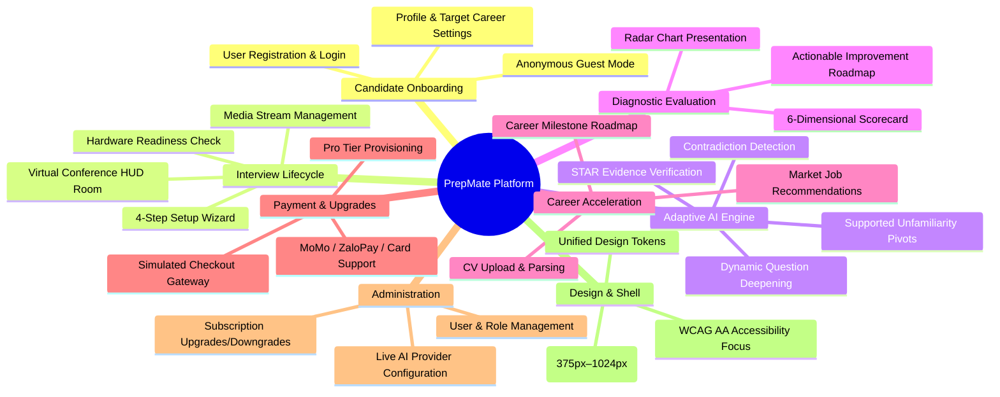

# PrepMate — Feature Overview

## 1. Feature Map

PrepMate provides 8 primary functional feature groups:

---

## 2. Page & Route Directory

All pages are located under `FE/`:

| Page / Route | Primary Purpose | Required Role |
| :--- | :--- | :--- |
| `/index.html` | Public landing page, 5-industry interactive simulator, value proposition | Public / Guest |
| `/404.html` | Custom error page with fallback navigation | Public / Guest |
| `/features/about/about.html` | Platform background, educational mission, team overview | Public / Guest |
| `/features/help/help.html` | FAQ, interview preparation guides, audio/camera troubleshooting | Public / Guest |
| `/features/auth/auth.html` | Registration and login interface with validation feedback | Public / Guest |
| `/features/dashboard/dashboard.html` | Candidate dashboard, recent interview history, performance metrics | Authenticated User |
| `/features/interview/interview-info.html` | 4-step interview configuration wizard & readiness check | Guest / User |
| `/features/interview/interview-practice.html` | Live virtual interview room HUD (Camera, Mic, Chat, Timers) | Guest / User |
| `/features/interview/history.html` | Full archive of candidate's past interview sessions | Authenticated User |
| `/features/report/report.html` | Comprehensive STAR evaluation scorecard and feedback breakdown | Guest / User |
| `/features/profile/profile.html` | Candidate profile, target roles, experience level, bio | Authenticated User |
| `/features/profile/cv.html` | CV dropzone, resume viewer, parsed skill badges | Authenticated User |
| `/features/profile/settings.html` | Account preferences, security settings, notification options | Authenticated User |
| `/features/jobs/jobs.html` | Job matching portal and requisite skill recommendations | Authenticated User |
| `/features/progress/progress.html` | Career milestone tracker and skill progression roadmap | Authenticated User |
| `/features/qbank/qbank.html` | Industry question bank categorized by domain and difficulty | Authenticated User |
| `/features/payment/pricing.html` | Subscription plan comparison (Free vs Pro) | Public / User |
| `/features/payment/payment.html` | Checkout portal for simulated payment processing | Authenticated User |
| `/features/admin/admin.html` | Admin console for users, roles, subscriptions, AI settings | Manager / Admin |
| `/features/design-system/showcase.html` | Living UI component styleguide and token showcase | Public / Internal |
