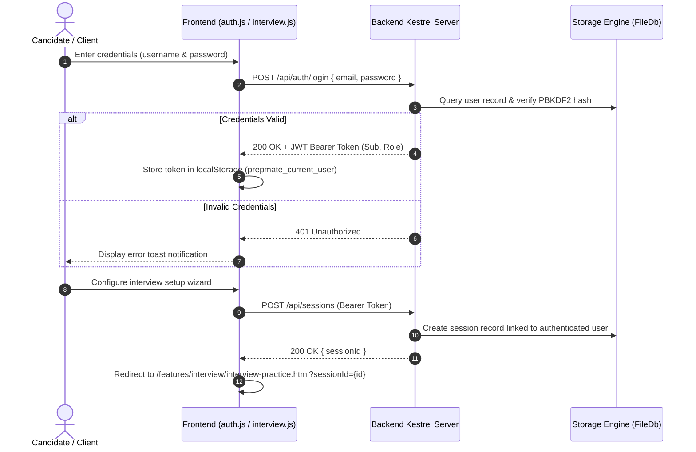
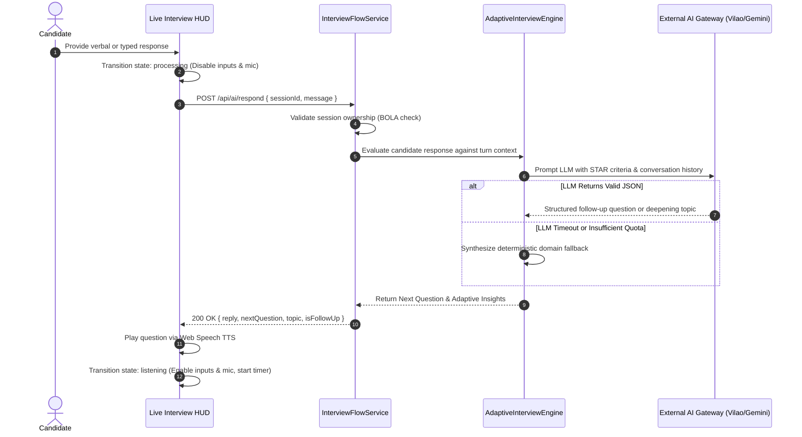
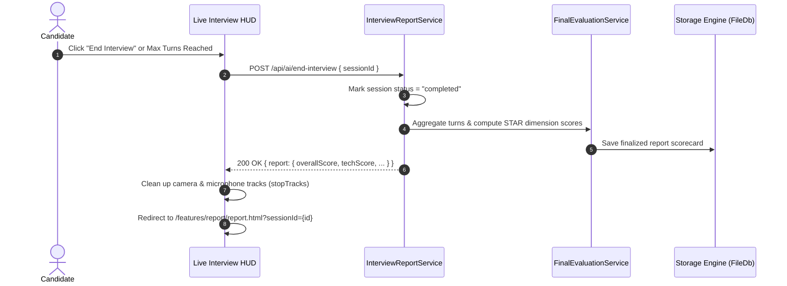

# PrepMate — System Flows & Sequences

## 1. Authentication & Session Initialization Flow

---

## 2. Live Adaptive Interview Turn Sequence

---

## 3. Interview Conclusion & STAR Report Generation Flow

